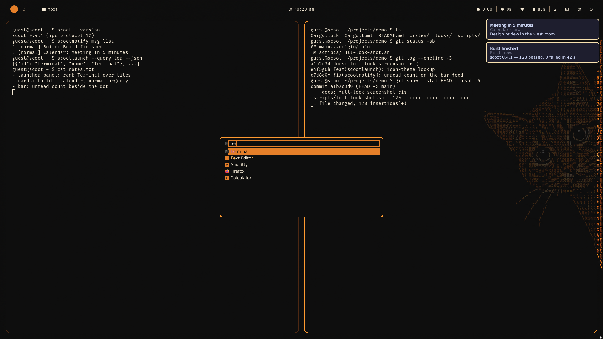

# scoot

[](https://github.com/scoot-sh/scoot/actions/workflows/ci.yml)

**scoot knocks your windows sideways.** It is a light Wayland compositor
that puts windows in columns on a strip that scrolls left and right. A
new window never squeezes the others; the strip just gets longer.



## See it now

No install. Start the desktop in your browser with
[Docker](https://docs.docker.com/get-started/get-docker/):

```sh
docker run --rm -p 127.0.0.1:6080:6080 ghcr.io/scoot-sh/try-scoot
```

Open `http://127.0.0.1:6080` and click the desktop. Press `Alt+Return`
for a second terminal. The port stays on loopback because VNC has no
password. To stop, press `Ctrl+C` where you started the container.

On Linux with [Nix](https://nixos.org/download/), this opens
scoot in a window on your current desktop (installs nothing):

```sh
nix shell --accept-flake-config github:scoot-sh/scoot nixpkgs#foot --command scoot --nested -- foot
```

Close the window to quit. If Nix starts to compile, your Nix does not
trust the cache yet: [add it](https://www.scoot.sh/start/install/#or-in-a-window-on-linux-nix).

## Pick your way in

| You want to… | Do this |
|---|---|
| Try it **in a browser**, with no install | `docker run` above, then open `http://127.0.0.1:6080`. [Install → Try it in your browser](https://www.scoot.sh/start/install/#try-it-in-your-browser) |
| Use it every day on **NixOS** | Add the flake and turn on `programs.scoot.desktop`. You get a bar, wallpaper, lock, notifications and a launcher. [Install → Use it every day](https://www.scoot.sh/start/install/#use-it-every-day) |
| Use it every day on **Debian, Ubuntu, Fedora, openSUSE or Arch** | Packages are coming. Today, build one from this repo in a few steps. [Install](https://www.scoot.sh/start/install/#use-it-every-day) |
| Keep it on **any Linux with Nix** | `nix profile add github:scoot-sh/scoot#scoot github:scoot-sh/scoot#scootbar github:scoot-sh/scoot#scootbg` |
| Drive it **from a script or an agent** | `scoot --headless -- foot`, then `scoot msg screenshot --out shot.png`. [Agents](https://www.scoot.sh/agents/) |
| Build a desktop **from the parts** | [Build your desktop](https://www.scoot.sh/start/compose/) |

## Why scoot

- **No GPU? No problem.** scoot draws with the CPU or the GPU, and both
  renderers are first-class. It runs on real hardware, in a VM with no
  3D, in a container, or inside another desktop. The default
  (`--renderer auto`) picks the right renderer for the session, and
  `--renderer cpu` or `--renderer gpu` always overrides it.
  ([Builds and renderers](https://www.scoot.sh/reference/builds/).)
- **Agents can drive it.** One socket types, clicks, takes screenshots,
  lists windows, and waits for the
  screen to settle. scoot's own tests drive it this way.
- **It stays out of the way.** An idle scoot does not wake up, nor do the
  bar and the wallpaper daemon.
  ([Benchmarks](dev/benches/benchmarks.md).)

If you want the most mature scrolling compositor, use
[niri](https://github.com/niri-wm/niri). It inspired
scoot.

## Five keys

`Super` is the Windows or Command key.

| Keys | Does |
|---|---|
| `Super+Return` | Open a terminal |
| `Super+h` / `Super+l` | Focus the column to the left / right |
| `Super+q` | Close the window |
| `Super+Shift+/` | Show every key |
| `Super+Shift+e` | Quit scoot |

All keys, and how to change them: [Keybindings](https://www.scoot.sh/scoot/keybindings/).

## Make it yours

scoot reads `~/.config/scoot/config.toml`. Every setting is optional,
and a mistake never stops scoot from starting. To get the commented
defaults:

```sh
scoot --print-default-config --write
```

`scoot msg reload` applies a change without a restart. Every option is
on [Configure](https://www.scoot.sh/scoot/configure/). Five ready-made
looks (black, light, dark, warm, chill) are on
[Theming](https://www.scoot.sh/scoot/theming/).

## What comes in the box

| Piece | What it does |
|---|---|
| `scoot` | The compositor, plus `scoot msg`, its control client |
| `scootbar` | A status bar: workspaces, clock, sound, network, battery, tray. It also works on sway, niri and Hyprland. |
| `scootbg` | A wallpaper daemon. Set `[wallpaper]` in the config and scoot starts it. |
| `scootlaunch` | The default application launcher: an overlay panel with ranked search, plus dmenu and run modes. On Nix it is the default (`launcher.daemon = "fuzzel"` keeps fuzzel); elsewhere `install.sh --launch`. [Docs](https://www.scoot.sh/scootlaunch/) |
| `scootnotify` | A notification server: it owns `org.freedesktop.Notifications` and shows popup cards, with do-not-disturb, a history ring with restore, `[[rule]]` tables, and `scootnotify msg` for list, history, dnd, dismiss, invoke, reload, subscribe and wait. The default notification daemon on Nix (`desktop.notifications.daemon = "mako"` keeps mako), with deb, rpm and Arch packages and `install.sh --notify` elsewhere. [Docs](https://www.scoot.sh/scootnotify/) |
| `scoot-globalshortcuts-portal` | The GlobalShortcuts portal backend: it owns `org.freedesktop.impl.portal.desktop.scoot`, registers app shortcuts with the compositor over IPC, and turns presses and releases into portal signals. Media keys and push-to-talk that work while another app holds focus. |

Standard Wayland protocols mean the usual tools work: other bars,
launchers, notification daemons, screen sharing, screen lockers and
X11 apps (with the XWayland build). [Full list](https://www.scoot.sh/scoot/protocols/).

## Not yet

- **Changing display modes from `wlr-randr` or Settings.** Read-only for
  now. Set modes in the config file.
- **Some X11 extras.** X input methods (XIM) and X window icons.
- **A macOS compositor.** On a Mac, `scoot msg` drives scoot in a Linux VM.

## Docs

Everything else is on **[scoot.sh](https://www.scoot.sh/)**. What
changed is in [CHANGELOG.md](CHANGELOG.md), and what is next is in
[ROADMAP.md](ROADMAP.md). To build or contribute, start at
[dev/README.md](dev/README.md).

## License

MIT. See `NOTICE` for third-party attribution. scoot is built on
[Smithay](https://github.com/Smithay/smithay).
