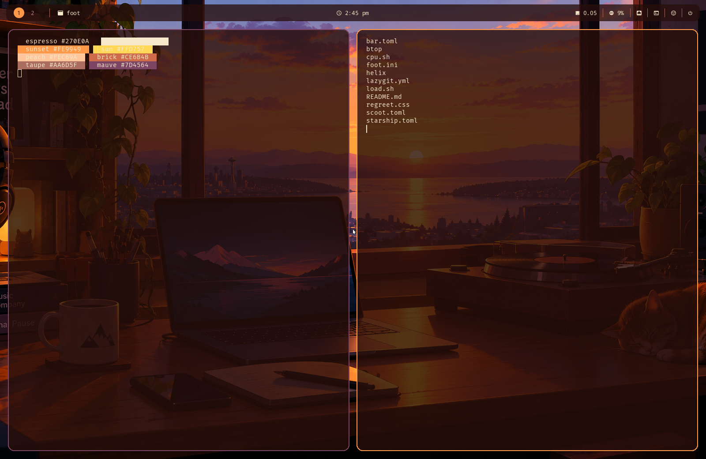

# The vinyl sunset look — warm

A warm, dark look built around one image: a desk-sunset scene with a
turntable, a laptop and a sleeping cat, made by the maintainer. It is an
**opt-in example**, not a default: nothing in scoot,
scootbar or scootbg changes unless you use these files. The wallpaper ships
in this repository (`docs/assets/wallpapers/vinyl-sunset.png`, under MIT;
see "Image credit and license"), and [`scoot.toml`](scoot.toml) points at it.



| File | For |
| --- | --- |
| [`scoot.toml`](scoot.toml) | the compositor: background, ring colors and widths, rounded corners, gaps, the wallpaper |
| [`bar.toml`](bar.toml) | scootbar: a floating, rounded, translucent bar, workspaces as discs with the focused window's title, the clock, system modules, two command-fed modules, launcher buttons and the power menu |
| [`foot.ini`](foot.ini) | foot: the palette, 80% opacity, padding and font size (needs a foot with `[colors-dark]` sections, 1.26 or later) |
| [`starship.toml`](starship.toml) | starship: the prompt in the illustration's palette |
| [`helix/config.toml`](helix/config.toml) | Helix: relative line numbers, cursor line, the theme below |
| [`helix/themes/scoot-vinyl.toml`](helix/themes/scoot-vinyl.toml) | Helix: the transparent palette theme |
| [`btop/btop.conf`](btop/btop.conf) | btop: a dark transparent setup naming the theme below |
| [`btop/themes/vinyl.theme`](btop/themes/vinyl.theme) | btop: the sunset palette theme |
| [`lazygit.yml`](lazygit.yml) | lazygit: the palette, rounded borders |
| [`load.sh`](load.sh), [`cpu.sh`](cpu.sh) | the bar's `load` and `cpu` modules: load average and CPU percent on stdout |
| [`regreet.css`](regreet.css) | ReGreet: the login screen in espresso, cream and sunset orange (NixOS greeter) |

It needs `scootbg` on your `PATH` for the wallpaper (scoot starts it itself; the Nix
modules install it when the settings have a `[wallpaper]` table, or, from source,
`cargo install --path crates/scootbg`), a font file
for scootbar (see the comment in [`bar.toml`](bar.toml)), and `load.sh` and
`cpu.sh` somewhere on your `PATH` (see the comment in [`bar.toml`](bar.toml)).
Without `scootbg` scoot logs one
warning and carries on with the background color. The rest is optional:
starship, Helix, btop and lazygit each read their file only if you run them;
btop needs the theme copied beside its config (see below).

Try it from a checkout, each in its own terminal (scootbar and foot once scoot is up):

```sh
scoot --config docs/examples/vinyl-sunset/scoot.toml
PATH="$PWD/docs/examples/vinyl-sunset:$PATH" scootbar daemon --config docs/examples/vinyl-sunset/bar.toml
foot --config docs/examples/vinyl-sunset/foot.ini
```

To keep it, copy the files to your config directory (`~/.config/scoot/config.toml`,
`~/.config/scoot/bar.toml`, `~/.config/foot/foot.ini`,
`~/.config/starship.toml`, `~/.config/helix/`, `~/.config/btop/btop.conf`
with `btop/themes/vinyl.theme` as `~/.config/btop/themes/vinyl.theme`,
`~/.config/lazygit/config.yml`) and point `[wallpaper] image` at
a copy of the wallpaper. The prompt in the preview runs under
`STARSHIP_CONFIG` pointing at `starship.toml`, e.g.
`env STARSHIP_CONFIG=~/.config/starship.toml bash -i`.

## The login screen

On NixOS the greeter can wear this look too. Copy `regreet.css` and
`docs/assets/wallpapers/vinyl-sunset.png` next to your system configuration:

```nix
programs.scoot = {
  enable = true;
  greeter = {
    enable = true;
    background = ./vinyl-sunset.png;
  };
};
services.displayManager.regreet = {
  extraCss = ./regreet.css;
  font = {
    package = pkgs.dejavu_fonts.minimal;
    name = "DejaVu Sans";
    size = 12;
  };
  settings = {
    GTK.application_prefer_dark_theme = true;
    background.fit = "Cover";
    widget.clock.format = "%-I:%M %P";
  };
};
```

See [the greeter docs](../../nix.md#the-greeter-regreet-opt-in) for the
one-screen default and the other knobs.

## The palette

The image's colors: espresso `#270E0A`, cream `#F6E8CB`, sunset orange
`#FE9949` (accent and focused ring), sun yellow `#FFD757`, peach `#FEC69A`,
inactive-ring mauve `#7D4564`, taupe `#AC6F61`, brick `#CE6B4B`,
olive (`#A5C643`, bright `#B8D26A`), dusk blue (`#6A7FBD`, bright `#95A4D0`),
rose (`#B2676D`, bright `#C89397`), steel (`#878CB6`, bright `#ADB0CD`) and
sand `#EAC985`. The focused window's ring is orange and the
others' dark mauve; the bar, foot, starship, Helix, btop and lazygit are all
themed from these hues.

## What it costs

The defaults stay light on purpose; this look spends some of that, so each piece is
opt-in and you can drop any of them:

- **The wallpaper** makes scootbg hold the decoded image: about 12 MB RSS at 1920x1080
  and about 37 MB on two 4K outputs, against about 4 MB for a solid color (measured with
  a larger JPEG, but the buffer follows the output, not the file;
  [scootbg](../../scootbg/README.md)). Drop `[wallpaper]` for a solid
  `background_color` and the cost is gone.
- **`corner_radius`** costs a little per frame when non-zero (measured at about +9% on a
  three-window session under pixman; see [appearance](https://www.scoot.sh/scoot/appearance.md)).
  `0` is free.
- **The translucent bar** (`opacity`) needs an ARGB buffer and no opaque region. On the
  Asahi M2 the shaped and translucent looks cost no more than a flush one that the
  method could resolve; see the [resource ratchet](../../scootbar/backlog/lightest.md#appearance-looks-flush-against-floating).
  Set `opacity = 1` (and `radius = 0`) for the plain bar.
- **The translucent terminals** (foot's `alpha=0.80`) make each terminal window non-opaque,
  so scoot blends it over the wallpaper whenever that region is redrawn. In the optional
  `gpu-scanout` `--tty` tier, a fullscreen translucent window also cannot be handed to the
  display directly ([backends](https://www.scoot.sh/scoot/backends.md)). That extra work was not measured here. Set
  `alpha=1.0` in [`foot.ini`](foot.ini) for opaque terminals.
- **The `load` and `cpu` modules** each hold one shell that sleeps (10 s and 5 s) and
  prints a line: no polling by the bar, one process each, woken by their own timers.

## Image credit and license

The wallpaper is an AI-generated image made by the maintainer: a sunset over
a bay and city seen through a window, with a wooden desk, laptop, turntable,
headphones, plants and a sleeping cat. It ships in this repository as
`docs/assets/wallpapers/vinyl-sunset.png` and
`looks/vinyl-sunset/wallpaper.png`, under this repository's MIT license.
The preview `docs/assets/vinyl-sunset-preview.png` is a screenshot of this
example with the wallpaper. See [NOTICE](../../../NOTICE).
