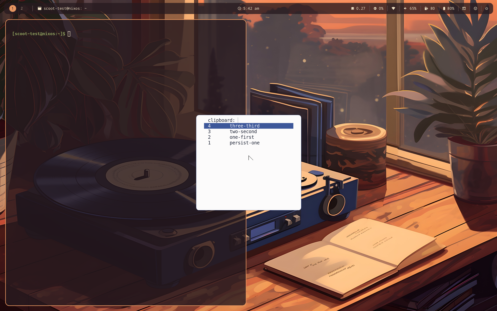

Copy in one window, close it, and the paste still works: every copy
lands in a history kept by cliphist, restorable with one keypress.
Without this slot, a copy dies with the app that offered it — from
your side of the screen that reads as data loss, and agents move text
through the clipboard constantly, so the profile turns it on.

```nix title="configuration.nix and home.nix"
programs.scoot.desktop = {
  enable = true;
  # A longer tail in a moved db:
  # clipboard.maxItems = 250;
  # clipboard.dbPath = "/home/you/.cache/cliphist-test/db";
  # No history at all on this box (each switch below is its own):
  # clipboard.enable = false;
};
```

What runs: two watcher units (regular clipboard and primary selection,
in `scoot-session.target`, so no other desktop starts them), each a `wl-paste --watch`
feeding one shared history, plus `wl-copy`/`wl-paste` on `PATH`.
The history keeps 100 entries by default
(oldest dropped first, each entry at most 5 MB), byte-for-byte:
trailing newlines survive, and so do images. Press `Super+v` and the
picker shows the newest first; Enter restores the picked entry to the
clipboard, then paste as usual:



Wayland selections are owner-held: the *history* survives the source app
closing (and a reboot — it lives in a db on disk), while the *live*
selection still dies with its owner. So `Ctrl+v` right after closing
the source finds nothing — open the picker, Enter, paste.

Password-manager copies never land in history, by construction: such
an offer carries the `x-kde-passwordManagerHint` MIME type, for which
the watcher stores nothing. Managers that do not set the hint are
*not* excluded — treat the history as sensitive-adjacent anyway. Try
it: `wl-copy --sensitive` copies, and the history stays empty.

Over the session lock, two halves: the history is wiped as the session
locks (pre-lock copies never sit on disk behind the lock screen), and
nothing copied during the lock is recorded. Without the idle policy
there is no lock event to ride, so a standalone clipboard wipes
manually (`cliphist wipe`). The db lives at cliphist's default
(`~/.cache/cliphist/db`, honoring `XDG_CACHE_HOME`) unless `dbPath`
moves it — on disk, so history survives reboots. That is the privacy
trade-off, stated whole: convenience against exposure (any same-uid
process reads the db file). Secrets never land there by the mechanism
above, the lock wipes it every lock,
and `wipe` empties it any time; there is deliberately no encrypt-at-rest.

Every value is an option, applied on rebuild/switch (the units restart
into the new config; no re-login):

| Option | Type | Default | Meaning |
|---|---|---|---|
| `desktop.clipboard.enable` | bool | `true` with the profile | keep history (two watcher units), `wl-copy`/`wl-paste` on `PATH`, the picker bind |
| `desktop.clipboard.maxItems` | int (at least 1) | `100` | history entries kept, oldest dropped first |
| `desktop.clipboard.dbPath` | string or null | `null` (cliphist's default) | history db path: absolute, letters, digits and `._/+@-` only; anything else fails evaluation |
| `desktop.theme.targets.clipboard.enable` | bool | `true` | theme the picker from the look; `false` keeps the menu's own style |

Troubleshooting, by symptom:

- *Close the app and the paste is empty.* That is the live selection,
  not the history: open the picker (`Super+v`), Enter on the entry,
  paste. If the *picker* is empty too, the watcher never stored it:
  `systemctl --user status scoot-clipboard-store` (and
  `-primary-store`), then `cliphist list`.
- *`Super+v` opens nothing.* The slot renders that bind only with
  `clipboard.enable` beside the keymap (both on with the profile).
  Then check the menu: `scootlaunch --dmenu` from a terminal — with an
  empty history it exits at once, which is the picker staying quiet,
  not an error.
- *Escape clears my clipboard.* It does not: a cancelled pick exits
  before `wl-copy` runs. If the selection changed anyway, another
  manager runs beside this one — only one watcher per selection
  should run.
- *A password is in the history.* The offering app did not set the
  hint: delete it (`cliphist list | scootlaunch --dmenu | cliphist
  delete`, or `wipe` for all of it) and tell the app to set it.
- *Copies made while locked are in the history.* The store entry's
  probe failed open: check `scoot-clipboard-store` and the
  compositor's socket. The wipe still ran at lock, so pre-lock
  entries are gone regardless.
- *Two pickers / two histories.* Another manager runs beside this
  one: only one should. Turn this one off or uninstall the other.
