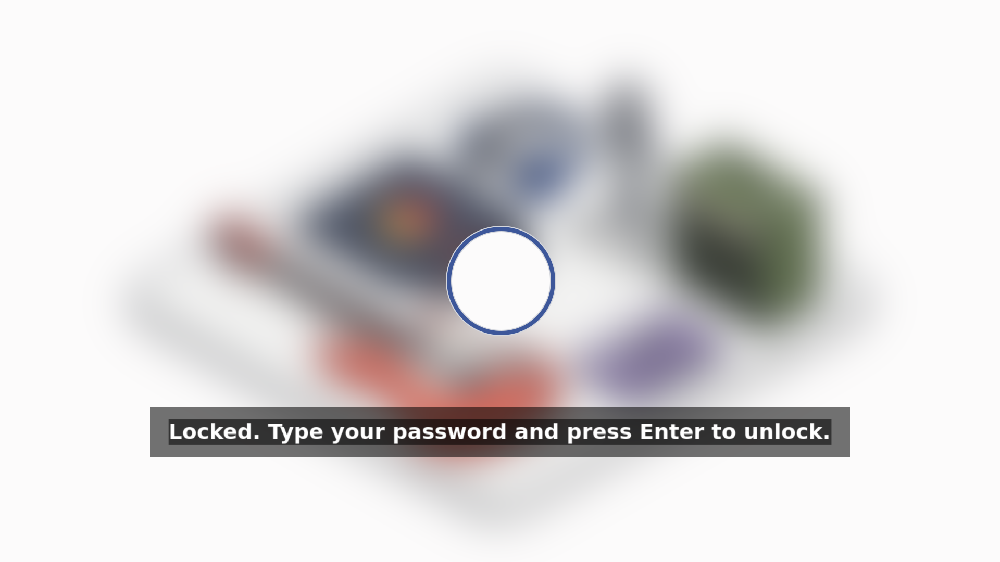

Idle and lock come on with the profile. After this many seconds without input:

| At | What | Why this step |
|---|---|---|
| 2 min | the panel dims to 10% (`brightnessctl -s set 10%`, restored on activity) | the backlight is most of idle draw (measured on the M2: 4.55 W screens on, 1.52 W both off) |
| 4 min | the session locks (`loginctl lock-session`, locker over `ext-session-lock-v1`) | after dim, **before** screens off, so the lock is already up when the panel goes dark and no unlocked frame is ever visible on wake |
| 5 min | every output powers off (`wlopm --off '*'`, back on at the first input, locked or not; with [display profiles](./displays.md) on, the matched profile then re-applies, so its `disabled` outputs stay off) | the measured 3 W saving |
| sleep | locks first, then sleeps (swayidle's `before-sleep`, waited on) | suspend must never land on an unlocked session |
| docked lid close | locks, does not suspend | a closed lid on a multi-output box means the user walked away, not that the session should die |

Audio holds the whole sequence off while anything plays (any sink or
source running), so music or a call never dims the panel. Any input
restarts every timer from zero, so there is nothing to reset after
unlock. One timeout set covers AC and battery alike.

The locker follows the look: screen and indicator from its palette (a
value in `lock.settings` winning per key, `theme.targets.lock.enable =
false` dropping the themed block while the rest follows the look).
Locked, the look's wallpaper shows behind everything, blurred at build
time, with the indicator always visible and a message saying what to
do — no blank frame, no guessing. The music-desk palette over its
blurred wallpaper (captured from a real session through scoot's own
IPC screenshot path):



Without a wallpaper the lock falls back to a navy screen, still with
the indicator and the message; with no look at all it is the same navy
screen with a white ring. A wrong password says so
(`Wrong password. Try again.`), and the screen still locks even if an
image cannot load — an unthemed lock beats no lock.

The blur is built from the wallpaper of the look you configure in Nix.
A wallpaper you set at runtime (`scootbg set`, a slideshow, `scoot look
apply`) is not picked up, even by a rebuild: the lock keeps the built
blur. Per-output runtime blur is tracked as follow-up work.

If you set `desktop.idle.lock.package` yourself, it must match
`desktop.idle.lock.daemon`. A locker that does not know a key in the
config stops reading it there and locks with what it parsed, which can
be a flat color with no message.

Unlock checks your password through PAM, as `swaylock`. On NixOS the
scoot module names that service itself, so unlocking works with no
extra setup. On any other Linux, home-manager cannot provide it: set
up `/etc/pam.d/swaylock` wherever PAM is configured, or no password
will ever unlock.

```nix title="configuration.nix"
security.pam.services.swaylock = {};
```

Every value is an option, applied on rebuild/switch (the units restart
into the new config; no re-login):

| Option | Type | Default | Meaning |
|---|---|---|---|
| `desktop.idle.enable` | bool | `true` with the profile | run the policy (dim, screens off, sleep lock, audio hold) |
| `desktop.idle.dimTimeout` | int (seconds) | `120` | inactivity before dimming; `0` disables the step |
| `desktop.idle.dimLevel` | int (percent, 1-100) | `10` | brightness the dim step sets |
| `desktop.idle.lockTimeout` | int (seconds) | `240` | inactivity before locking; `0` disables the step (sleep still locks) |
| `desktop.idle.offTimeout` | int (seconds) | `300` | inactivity before outputs power off; `0` disables the step |
| `desktop.idle.mediaInhibit.enable` | bool | `true` with the profile | hold idle while audio plays (needs PipeWire or PulseAudio running) |
| `desktop.idle.lock.enable` | bool | `true` with the profile | lock through the locker below |
| `desktop.idle.lock.command` | string | `loginctl lock-session` (system path on NixOS) | the stable lock action: what the timeout runs, and what the keymap's `Super+Escape` bind runs — lid-close and manual locks share this path through logind |
| `desktop.idle.lock.daemon` | enum (`"swaylock-effects"`, `"swaylock"`) | `"swaylock-effects"` | the locker behind the action: the effects fork (blurred screen, always-visible indicator, unlock message; a future scootlock widens this without renaming anything), or stock swaylock one line back (the same blurred screen, hidden-until-you-type indicator, no message) |
| `desktop.idle.lock.settings` | attrset of string | `{ }` | extra locker lines over the themed ones (a value here wins per key) |
| `desktop.theme.targets.lock.enable` | bool | `true` | theme the locker from the look; `false` keeps swaylock's own style while the rest follows the look |

```nix title="configuration.nix and home.nix"
programs.scoot.desktop = {
  enable = true;
  # Later to bed: lock at 10 min, screens off at 15.
  idle.lockTimeout = 600;
  idle.offTimeout = 900;
  # No idle policy at all (the profile turns the set on; each switch below
  # turns its piece back off):
  # idle.enable = false;
  # idle.lock.enable = false;
  # idle.mediaInhibit.enable = false;
};
```

Troubleshooting, by symptom:

> **Symptom:** Lock screen rejects the right password.
>
> No `swaylock` PAM service exists, so PAM falls back to `other`,
> which denies everything. On NixOS set
> `security.pam.services.swaylock = {};` (automatic with the scoot
> NixOS module); on any other Linux provide `/etc/pam.d/swaylock`
> wherever PAM is configured. A locker already running keeps failing:
> it reads PAM once at launch. Kill it (`pkill -x swaylock`); the
> session stays locked behind a red screen, and the next lock starts a
> new locker that reads the new service. Check Caps Lock second — the
> indicator shows its state while you type.

- *Screens never dim or power off.* Check the unit is running:
  `systemctl --user status scoot-idle` — and that it started with the
  display (a hand-started session must reach `scoot-session.target`
  with `WAYLAND_DISPLAY` imported, [on the desktop page](./index.md#which-sessions-start-the-units)). The generated config is at
  `~/.config/swayidle/config`: read it, the timeouts are literal. Dim
  specifically needs the seat: logind grants the *active* login
  backlight access, so dim works in the seat session and logs EPERM
  anywhere else (over ssh, from a timer with no session).
- *The timeout passes and the session never locks.* The locker is
  probably exiting immediately: run `swaylock -f -C
  ~/.config/swaylock/config` by hand — if it drops straight back to the
  prompt, its error names the cause.
- *`loginctl lock-session` does nothing visible.* Something must listen
  for logind's Lock: that is the policy's `lock` event, so `scoot-idle`
  is not running or `lock.enable` is off.
- *Music dims the panel.* The hold needs the inhibitor unit *and* an
  audio server: `systemctl --user status scoot-audio-inhibit` plus
  something actually playing. Without a server the unit backs off and
  stays stopped.
- *Closing the docked lid suspends.* Something beat the profile's
  docked-lid lock rule: your own logind setting wins over it.

Without the flake, the same policy is a hand-written swayidle setup —
see [Idle in the compositor reference](../scoot/configure.md#idle-locking-and-screen-power).
