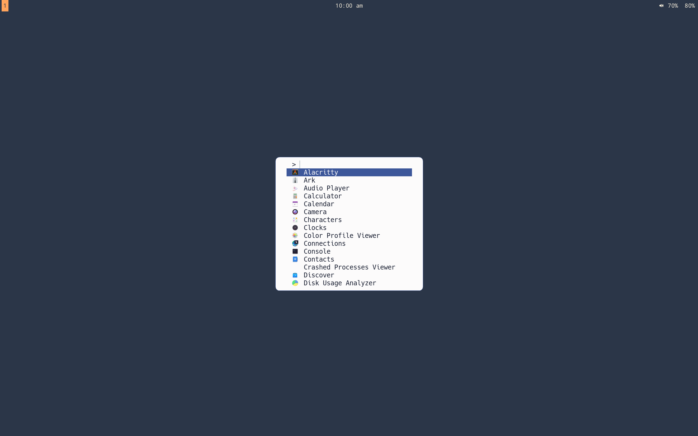
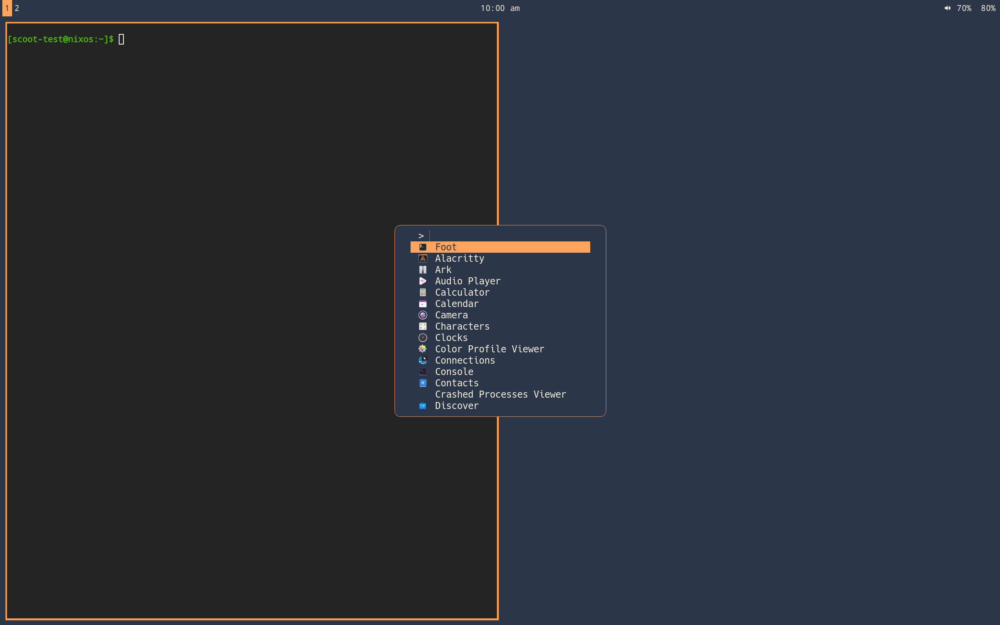

Press `Super+d`, type a few letters, Enter — the app opens. Without
this slot a fresh desktop's launcher key does nothing; with the
profile on, two binds open one menu:

```nix title="configuration.nix and home.nix"
programs.scoot.desktop = {
  enable = true;
  # The menu on Super+d lists XDG apps, most-launched first;
  # Ctrl+Alt+Space lists PATH executables on their own panel:
  # launcher.enable = false;  # no menu at all on this box
};
```

What runs: `Super+d` spawns `scoot-launcher` (drun: every XDG app —
the user's `~/.local/share/applications` plus the system's
`XDG_DATA_DIRS`, most-launched first), `Ctrl+Alt+Space` spawns the
same script with `--list-executables-in-path` (run: PATH executables
on their own panel). The menu draws on the **`overlay`** layer with
exclusive keyboard — above fullscreen windows, taking every key while
open. There is no daemon, no unit, no
config file: the launcher holds nothing when closed (no process, no
memory — verified below). The ranking lives in scootlaunch's own history
(`$XDG_STATE_HOME/scootlaunch/history`); a second press while it is open
dismisses it, so one bind toggles.

The menu follows the look: background and text, selection and border
from its palette, through the look layer at every open (a value you set in
your own `launch.toml` — font, width, rows — winning per key as
usual, `theme.targets.launcher.enable = false` leaving the whole look
out while the rest follows it). In music-desk paper and ink:



And in moonrise (same menu, same flags, that look's roles —
captured from a real session through scoot's own IPC screenshot path):



Why scootlaunch, measured against fuzzel 1.14.1 on the M2
(`dev/benchmarks/launcher-ab-2026-10.md`, N=30 per cell, release
binaries, same session): tied inside the method floor up to 1000
entries, clearly faster at 5000 (101–102 vs 184 ms median
launch-to-first-frame), query update flat while fuzzel climbs from 26 to
53 ms at 5000 (scootlaunch's values sit below the measurement floor, so only the
ranking is reliable), about half the memory (8.7 vs 18.0 MB PSS at
5000), zero idle cost and zero resident cost on both sides. Ranking
agrees on the winner for all 10 probes.

The dmenu contract is the slot's other half, and the reason the
clipboard picker already speaks it: lines on stdin, the selection on
stdout, with `--no-run-if-empty` staying quiet on
an empty history and `--only-match` refusing custom entries — the
pickers' flags. Proven live, not just documented: `printf
'alpha\nbeta\ngamma\n' | scootlaunch --dmenu`, the filter and Return driven
through scoot's own IPC, prints `beta` and exits 0. The clipboard
picker, the WiFi/Bluetooth pickers and the screencast chooser run the
same switch through its `--dmenu`, and the bar's WiFi / power /
audio pickers swap daemons without changing a call site. Two
script-visible differences from fuzzel's dmenu, both handled inside
the slot's scripts (a cancel exits 0 from every picker either way):

- Dismissing the menu exits 1. Fuzzel's dmenu exits 2 there (its app
  mode exits 0). A script that keys on fuzzel's 2 breaks under the
  default — treat any nonzero exit as a dismiss.
- The run bind lists PATH executables on their own panel. Fuzzel's
  `--list-executables-in-path` adds them beside the apps. The flag
  spelling is the same behind both binds; what it lists is not.

Launched apps land in the session: scootlaunch
forks the picked entry (a `Terminal=true` entry through your
terminal) and exits, and the window maps and takes focus through the
usual activation path. Over the session lock the binds never fire at
all (plain strings: never repeat, never `allow_when_locked`), so
there is nothing to refuse — and a manual run behind the lock only
lists app names, never clipboard or notification content.

Every value is an option, applied on rebuild/switch (the binds
re-render into `[binds]`; no re-login, `scoot msg reload` is enough):

| Option | Type | Default | Meaning |
|---|---|---|---|
| `desktop.launcher.enable` | bool | `true` with the profile | the package on PATH and both binds bound (drun on `Super+d`, run on `Ctrl+Alt+Space`) |
| `desktop.launcher.daemon` | enum (`"scootlaunch"`, `"fuzzel"`) | `"scootlaunch"` | the program behind `enable` (`fuzzel` is one line back: its color flags, its frecency cache, its additive run list — see [Migrating from fuzzel](#migrating-from-fuzzel)) |
| `desktop.launcher.package` | package or null | scootlaunch (Linux-only: null off Linux) | point at your own scootlaunch build; null with the switch on fails evaluation naming it |
| `desktop.theme.targets.launcher.enable` | bool | `true` | theme the menu from the look (background and text, selection and border); `false` leaves the menu's own style standing |
| `desktop.keys.binds.launcher.enable` / `.launcherRun.enable` | bool | `true` | bind the drun / run menu (`false` leaves that combo unbound) |

## Migrating from fuzzel

One line restores the previous menu:

```nix title="configuration.nix and home.nix"
programs.scoot.desktop.launcher.daemon = "fuzzel";
```

What changes back with it: the menu reads `fuzzel.ini` again (font,
lines, borders — scootlaunch never reads that file; it takes `font`,
`width_em`, `rows` from `programs.scootlaunch.settings` instead),
the look's seven colors travel as CLI flags again, frecency comes
from `$XDG_CACHE_HOME/fuzzel` instead of
`$XDG_STATE_HOME/scootlaunch/history`, a dismiss exits 2 from dmenu
instead of 1, and the run bind lists apps beside PATH executables
instead of executables alone. The binds, the wrapper name
(`scoot-launcher`) and every picker stay as they are.

Troubleshooting, by symptom:

- *`Super+d` (or `Ctrl+Alt+Space`) opens nothing.* The slot renders
  those binds only with `launcher.enable` beside the keymap (both on
  with the profile); either off leaves the combo unbound. Then check
  the binary: `scoot-launcher` from a terminal — outside the session
  it still lists apps, so a failure there names the cause (no
  compositor to map on, a bad `launch.toml` — `scootlaunch --check`
  says which).
- *The menu lists no apps.* scootlaunch found no `.desktop` files: it
  searches the `applications` subdirectory of `XDG_DATA_HOME` and
  `XDG_DATA_DIRS`. Inside the session both are set (try `echo
  $XDG_DATA_DIRS` in a terminal); over ssh they may be empty.
- *The wrong app keeps winning.* The
  most-launched sorts first. Reset it by deleting the history
  (`rm ~/.local/state/scootlaunch/history` with the menu closed).
- *My `launch.toml` font is ignored.* The file is read whole at every
  open — a bad file refuses loudly instead (`scootlaunch --check`
  names the key). With no file the first well-known font file wins;
  install DejaVu or set `font` to a file you have.
- *Two menus stack.* They cannot from these binds: the second press
  dismisses the open panel. A second menu means a
  second launcher (another menu tool running beside this one): turn
  this one off (`launcher.enable = false`) or uninstall the other.
