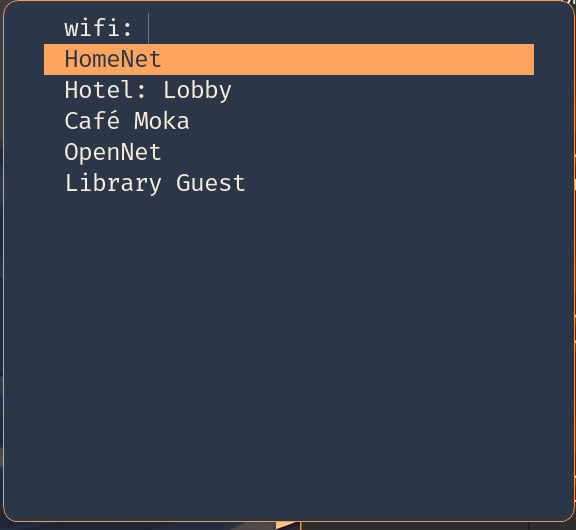
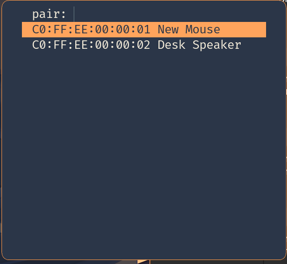

`Super+w` opens the WiFi picker and `Super+b` the Bluetooth one. The
bar opens the same pickers: a click on the network module (fed the
bar's own scan), and a click on the bluetooth module (the whole
`Super+b` menu; the module's own default click toggles the adapter's
power, which would drop a Bluetooth keyboard with one stray click, so
the profile rebinds the picker in its place (the module's own default click is the power toggle). The bluetooth module's
`menu` action (`scootbar msg invoke bluetooth menu`) opens the picker
fed the bar's device list. Both are dmenu menus through the
[launcher's dmenu contract](./launcher.md), themed like it, and both are
scripts over the stock CLIs (`nmcli`, `bluetoothctl`): nothing runs
between picks.



The profile installs the CLIs and never takes over a service:
NetworkManager and BlueZ are yours to enable
(`networking.networkmanager.enable`, `hardware.bluetooth.enable`).
Without them the pickers fail loud (below).

**WiFi.** The menu lists the networks in range from the cached scan
— saved ones first — then saved networks out of range. Pick one:

- A saved network (matched by its SSID, whatever its profile is
  named) connects at once: NetworkManager kept its key.
- An open network joins directly.
- A secured network asks for its key in a masked prompt, unless the
  keyring already holds it. To skip the prompt, stash it once:
  `secret-tool store --label='WiFi Home' scoot-wifi 'Home'`. The key
  reaches `nmcli` on stdin, never in an argument (the process table
  is readable by every user), and NetworkManager keeps it after the
  first join (system-owned, in `/etc/NetworkManager/system-connections`).
- A wrong key fails loud, and the failed join leaves no profile
  behind, so the next pick asks again. A key from the keyring that the
  network refuses (a changed password) brings up the prompt at once:
  the typed key joins, and NetworkManager keeps that one.
  Update the keyring entry yourself; the picker never writes it.
- Hidden and enterprise (802.1X) networks fail loud with no prompt: a
  key cannot join them. Join those once from a terminal (`nmtui`, or
  `nmcli device wifi connect NAME hidden yes --ask`); after that they
  are saved networks.

The picker reads the cached scan and never rescans: the bar's network
module scans when it opens its own menu, and NetworkManager rescans
on its own schedule. Once you have picked a network (and typed its
key), the join runs on its own: clicking the bar again closes an open
menu or key prompt (the one after a refused keyring key too), but
never cuts a join under way, so a failed one still cleans up after
itself.

**Bluetooth.** The menu opens on a state row (*Bluetooth is on (1
connected)*), and picking that row does nothing, so a stray `Enter`
never drops a device. Under it are the paired devices, starred while
connected: picking one connects it, or disconnects it if connected.
Low-energy devices (earbuds, mice) are listed too when they are not
advertising as discoverable. `bluetoothctl` prints those rows in gray,
and the picker lists them like any other.
Below them:

- *Pair a new device…* listens for 10 seconds, then lists the devices
  it found in pairing mode. A device that advertises without being in
  pairing mode (a neighbour's earbuds, a beacon) is left out:

  

  Pick one and it pairs, is trusted (so it reconnects on its
  own) and connects. The picker registers no pairing agent of its
  own, so BlueZ pairs the "just works" way (`NoInputNoOutput`), or
  through your session's default agent if one runs:
  headsets, mice, speakers and most keyboards pair this way. A device
  that insists on a typed PIN pairs from a terminal: `bluetoothctl`,
  then `scan on` and `pair MAC`.
- *Audio output…* (with the audio slot on) switches the default sink
  through `scoot-audio-sink`: pick the headset you just connected.
- *Turn Bluetooth off* or, while off, *Turn Bluetooth on* (the only
  row then).

A device is named by the name `bluetoothctl devices` lists (its
alias: the device's own name unless you renamed it) or by its own
name, which is what the bar shows; two devices answering to one name
are refused rather than guessed between (pick by address from
`Super+b`, which lists them).

Failures say why, as a notification and on stderr (the session
journal): no Wi-Fi device (a VM, a desktop without a card) or one
whose radio is off, NetworkManager not running (nmcli's own reason),
no Bluetooth controller, no BlueZ at all, or BlueZ's own reason for a
failed connect, pair or power switch (a failed pair stops there:
nothing is trusted or connected). Every `bluetoothctl` call is
bounded, since with no `bluetoothd` on the bus it waits forever: a
query (the list, a device's details) gives up after 5 seconds, a
connect after 30, a pair after 60, and the message names the bound it
hit ("BlueZ is not answering (no reply within 5 s …)" for a query). With
BlueZ running a call returns as soon as BlueZ answers, so `Super+b`
opens its menu at once. Cancelling a menu (`Escape`) joins and pairs
nothing.

The same scripts run from a terminal:

```sh
scoot-network-pick list            # the menu's rows
scoot-network-pick connect 'Home'  # join by SSID
scoot-bluetooth-pick list          # paired devices, * while connected
scoot-bluetooth-pick connect 'WH-1000XM4'   # or disconnect, pair; by name or MAC
scoot-bluetooth-pick power off
```

Every value is an option, applied on rebuild/switch (the binds
re-render into `[binds]`, so `scoot msg reload` is enough):

| Option | Type | Default | Meaning |
|---|---|---|---|
| `desktop.apps.network.enable` | bool | `true` with the profile | `nmcli` and the picker on `PATH`, `Super+w` bound, the bar's network module opening the picker |
| `desktop.apps.network.cliPackage` / `.menuPackage` | package or null | networkmanager / scootlaunch (Linux-only: null off Linux) | point at your own builds (the menu is the launcher's own, one derivation) |
| `desktop.apps.bluetooth.enable` | bool | `true` with the profile | `bluetoothctl` and the picker on `PATH`, `Super+b` bound, a click on the bar's bluetooth module (and its `menu` action) opening the picker |
| `desktop.apps.bluetooth.cliPackage` / `.menuPackage` | package or null | bluez / scootlaunch (Linux-only: null off Linux) | same |
| `desktop.theme.targets.network.enable` / `.bluetooth.enable` | bool | `true` | theme the picker from the look; `false` keeps the menu's own style |
| `desktop.keys.binds.network.enable` / `.bluetooth.enable` | bool | `true` | bind `Super+w` / `Super+b` (`false` leaves that combo unbound) |

The bar half needs the bar module imported and the module built in
(the default build has both). A `menu-command`, `connect-command` or
`on-click` you set in `programs.scootbar.settings` wins per key (set
`bluetooth.on-click = "toggle"` to have the power toggle back).

Troubleshooting, by symptom:

- *`Super+w` or `Super+b` does nothing.* Look for the notification
  first: every failure raises one. None at all means the bind never
  fired: the slot (`apps.network.enable` / `apps.bluetooth.enable`)
  or the keymap is off, or your own `settings.binds` took the combo
  (an older bar setup toggling the bar on `super+b`, say: yours wins.
  To keep both, give the picker another combo with
  `binds.bluetooth.enable = false` plus a `settings.binds` entry
  running `scoot-bluetooth-pick pick`).
- *"no usable Wi-Fi device".* `nmcli device` shows none of type
  `wifi`, or it is `unavailable`: a radio switched off
  (`nmcli radio wifi on`), rfkill, or no hardware.
- *"BlueZ is not answering".* `systemctl status bluetooth`: the
  daemon is not running, or `hardware.bluetooth.enable` is off.
- *A device is not in the pair list.* It was not in pairing mode
  during the 10-second listen: either it was not advertising, or it was
  advertising without being discoverable (`bluetoothctl devices` prints
  it in gray), which a device already paired to another computer or
  phone often does. Put it in pairing mode first, then pick *Pair a new
  device…* again.
- *"more than one device is named …"* (from the bar, or by name from
  a terminal). Two devices share a name: pick from `Super+b`, which
  lists them by address.
- *A network keeps failing with the right key.* A profile with an old
  key stays saved (one this picker did not create): `nmcli connection
  delete 'Home'`, then pick it again.
