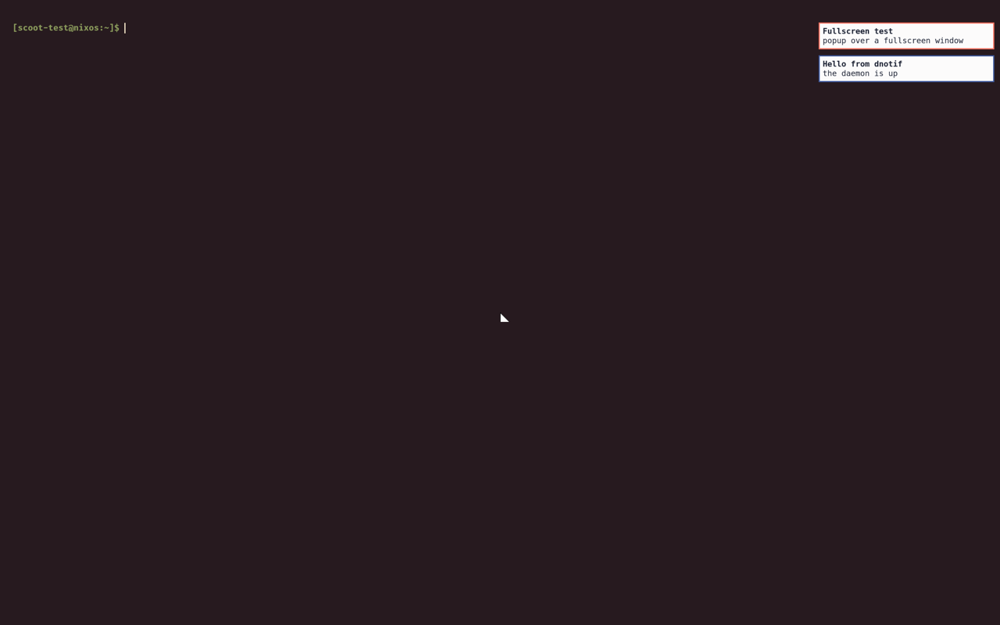

Notifications come on with the profile. The daemon is scootnotify,
owning `org.freedesktop.Notifications` on the session bus as a user
unit, with its popups on the **`overlay`** layer:

```nix title="configuration.nix and home.nix"
programs.scoot.desktop = {
  enable = true;
  # No daemon at all on this box:
  # notifications.enable = false;
};
```

Popups use `layer=overlay`, so they stay above fullscreen windows
(the frame then composites instead of scanning out directly; nothing
changes on screen, at the cost of one compositing pass). A critical
popup over a fullscreen window looks like this (blue ring for normal,
urgent ring for critical — captured from a real session through
scoot's own IPC screenshot path):



Overriding `anchor` moves the stack corner; the layer stays
`overlay` (scootnotify has no layer knob).

Over the session lock, nothing of a notification's content ever shows:
while locked the compositor draws nothing but the lock client's own
surfaces, so popups that arrive while locked wait in the daemon and
appear on unlock. The shot below is intentionally blank — it is
byte-identical to the frame just before the notification arrived, which
is the whole proof:


DND state and the unread count reach the bar through its `push` module —
the module is defined, not placed; show it with one line in your bar
config:

```toml
right = ["notifications", "clock"]
```

Each state has its own icon: a hollow circle
while idle, a solid dot beside the unread count, and a crescent moon
while do-not-disturb holds notifications (captured from a real session
through scoot's own IPC screenshot path, DejaVu Sans at 17 px):


The defaults are all in DejaVu Sans, the bar's default font, so they
render with no symbol font — and a default the font cannot draw fails
the flake's own checks instead of shipping a missing glyph. The old
envelope default is gone for exactly that reason: at bar size its fold
lines read as the X of a missing-glyph box. Each icon is overridable —
an empty `unread` or `dnd` sends no icon, so the static `idle` icon
shows beside the text (empty `idle` too for none) — and each is empty or
one glyph: two or more glyphs fail evaluation, since the bar refuses
them per update (two 2-byte glyphs such as `éé` slip past the check and
leave that state's last value shown, so do not use them). A Nerd Font glyph works wherever `bar.fallback-fonts`
provides one:

```nix title="home.nix"
programs.scoot.desktop.notifications.bar.icons = {
  idle = "○"; # the push module's static icon; "" shows nothing while idle
  unread = "●"; # sent beside the count, overriding idle while set
  dnd = "☾"; # sent while do-not-disturb is on, overriding idle while set
};
```

A future daemon keeps these option names: only the daemon behind
them changes. scootnotify pushes DND and the unread count to the
`push` module itself — no feed script runs beside it — and the bar's
click runs `scootnotify msg dnd toggle`:

```nix title="configuration.nix and home.nix"
programs.scoot.desktop.notifications.daemon = "scootnotify";  # the default; drop the line
```

With it, there is no mako package, no mako config and no feed script,
the three binds sit on `scootnotify msg`, and
`programs.scootnotify.settings` holds the daemon's own file (see
[scootnotify](../scootnotify/index.md#nix)). To go back, set `daemon = "mako"`
and switch again — see [Migrating from mako](#migrating-from-mako).

## Migrating from mako

One line restores the previous daemon:

```nix title="configuration.nix and home.nix"
programs.scoot.desktop.notifications.daemon = "mako";
```

Upgrading from a mako default: the switch replaces mako's unit,
config and feed with scootnotify's unit and activation file, and the
binds move to `scootnotify msg`. With home-manager's default (`startServices = true`, sd-switch) the
switch stops the removed mako unit. If mako is still running (`startServices` set to
`suggest`, no user systemd at switch time, or mako reactivated over D-Bus) it keeps the bus name and the new daemon exits 3
(the journal names the owner). If notifications go silent after the
switch, stop the leftover explicitly (`systemctl --user stop mako`,
or log out and back in) and check `systemctl --user status
scootnotify`.

What changes back with it: the daemon reads mako's flat config
dialect again (`notifications.settings`: `anchor`, `layer`, timeouts —
mako's own default layer is `top`, which hides popups under
fullscreen, so the profile still generates `layer=overlay`),
the look themes it per key through the generated fragment instead of
scootnotify's own notify layer, and the three binds and the bar's
click run `makoctl` (dismiss, `mode -t do-not-disturb`, restore)
instead of `scootnotify msg`. The bar feed returns as the
`scoot-notify-sync` user unit beside the mako unit. scootnotify's own
file (`programs.scootnotify.settings`: `max_visible`, timeouts,
`[[rule]]` tables, history ring) has no effect beside mako, and
mako's `notifications.settings` has no effect beside scootnotify — a
non-empty one warns at eval, naming where the values moved. A look
swap re-renders scootnotify's file and `scoot look apply` reloads the
running daemon live (cards, history and DND survive).

Every value is an option, applied on rebuild/switch (the units restart
into the new config; no re-login):

| Option | Type | Default | Meaning |
|---|---|---|---|
| `desktop.notifications.enable` | bool | `true` with the profile | run the daemon behind `daemon` (scootnotify pushes the bar feed itself; mako runs the feed script beside it) |
| `desktop.notifications.daemon` | enum (`"scootnotify"`, `"mako"`) | `"scootnotify"` | the daemon behind `enable` (mako is one line back: its flat config, its `makoctl` control, the feed unit — see [Migrating from mako](#migrating-from-mako)) |
| `desktop.notifications.settings` | attrset of string | `{ }` | extra mako lines over the generated ones (a value here wins per key, rendered verbatim; read only with `daemon = "mako"`) |
| `desktop.notifications.bar.icons.idle` | string: empty or one glyph | `"○"` | the bar's static icon while idle; `""` shows nothing while idle |
| `desktop.notifications.bar.icons.unread` | string: empty or one glyph | `"●"` | the icon the feed sends beside the unread count |
| `desktop.notifications.bar.icons.dnd` | string: empty or one glyph | `"☾"` | the icon the feed sends while do-not-disturb is on |
| `desktop.theme.targets.notifications.enable` | bool | `true` | theme the notification daemon from the look; `false` keeps the daemon's own style while the rest follows the look (beside scootnotify it writes `look = false` into `programs.scootnotify.settings`; all or nothing, and an explicit `settings.look` wins) |

Troubleshooting, by symptom (full diagnosis in [scootnotify troubleshooting](../scootnotify/troubleshooting.md)
and the [Symptom index](../troubleshooting/index.md)):

- *No popups at all.* Check the unit: `systemctl --user status scootnotify`
  (or `mako` with the mako escape hatch) — and that D-Bus knows it:
  `busctl --user list | grep -F Notifications` should name the
  daemon's owner.
- *Popups vanish under fullscreen.* The daemon lost its overlay
  surface: with the mako escape hatch, something set `layer` back to
  `top` — read `~/.config/mako/config` (the generated file), the first
  content line is the layer.
- *The bar shows nothing.* The module needs placing (the one line
  above), the bar needs the `push` feature, and the feed needs running:
  the daemon pushes itself, so check `scootnotify` — with the mako
  escape hatch, `systemctl --user status scoot-notify-sync` instead.
- *DND is stuck on.* `scootnotify msg dnd status` tells the state;
  toggle it back: `scootnotify msg dnd off` (or `makoctl mode -r
  do-not-disturb` with the mako escape hatch).
- *A popup stayed up for hours.* The escape hatch does that by default:
  mako has no timeout unless set — `makoctl dismiss -a` clears them
  all into history, or set one:
  `notifications.settings.default-timeout = "10000";` (milliseconds).
- *Two daemons fight over popups.* Another notifier owns the bus name
  instead: only one can. Turn this one off or uninstall the other.
- *scootnotify exits as soon as it starts.* The name is taken (mako
  still running): the journal names the owner and the exit status is
  3. Stop the other daemon (`systemctl --user stop mako`) and remove
  its D-Bus activation file, or it comes back on the next
  notification.
- *A custom state icon shows as a box.* The glyph is in neither the
  bar's font nor its fallbacks: add the symbol font to
  `bar.fallback-fonts` (see the scootbar Fonts section).
