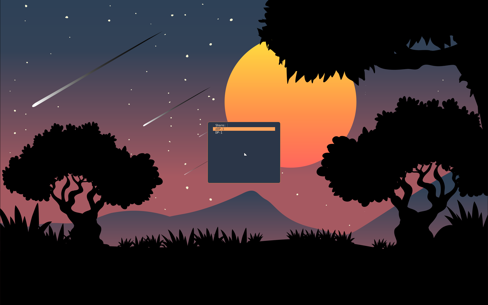

Share your screen in a Meet call, or screenshot a region into
`~/Pictures` — on with the profile, through the standard portals.
Chrome, Meet, OBS and Telegram work with nothing extra to start.

```nix title="configuration.nix and home.nix"
programs.scoot.desktop = {
  enable = true;
  # Share without being asked which screen (kiosk: one fixed output):
  # capture.chooser = "none";
  # capture.outputName = "eDP-1";
  # No screenshots or sharing at all on this box:
  # capture.enable = false;
};
```

What runs: the portal backends system-wide
(`xdg-desktop-portal-wlr` 0.8.4 or later for ScreenCast and
Screenshot, `xdg-desktop-portal-gtk` for the file chooser and the
rest — a too-old backend fails evaluation naming the floor, never a
cast that binds nothing), the `scoot` backend selection beside them
(ScreenCast and Screenshot to `wlr`, everything else to `gtk`: the
same file the home-manager side installs per user, which wins where
both exist), PipeWire running for the cast, `grim` plus `slurp` for
the screenshot binds, and the output chooser xdpw asks through before
each cast. The portals start on demand over D-Bus and hold nothing
until a cast asks — no daemon, no memory, no wakeups when you are
not sharing. Push notifications need nothing: the profile installs no
Push backend, and no installed backend advertises the Push portal, so
a pure scoot session runs no push daemon at all.

Three binds, each plain (fire once, never behind the lock screen):

| Press | Does | Lands |
|---|---|---|
| `Print` | screenshot every output | dated files in `~/Pictures` (`scoot-20261005-143022.png`) |
| `Shift+Print` | screenshot a picked region | dated file in `~/Pictures` |
| `Ctrl+Print` | screenshot a picked region | straight into the clipboard (`wl-copy`) |

The region picker dims the screens and draws the pick with the
look's ring and accent (slurp's own style without a look, or with
`theme.targets.capture.enable = false`).

Before each cast, xdpw asks *which screen*: a dmenu list of every
output through the profile's menu — the same `--dmenu` contract
the clipboard picker and the launcher speak, themed from the look,
so the three menus read as one. The list, not a
click, is the default on purpose: in a Meet flow the call lives on
one screen while the thing to share is on the other, and a menu
names outputs from the keyboard where a click-picker needs the
pointer on the right screen first. The alternatives are one option
away: `chooser = "slurp"` picks by clicking a screen, and `chooser = "none"` casts
`outputName` — a connector name as `wayland-info` lists it, e.g.
`"eDP-1"` — with no picker at all (leave it null and any output
casts). Casts are capped at 30 frames per second (`maxFps`, `0`
lifts the cap): plenty for a call, and it bounds the compositor's
copy cost. The menu, in the moonrise look, over a call:



One limit: scoot captures **outputs only**.
There is no per-window capture source, so a call's window picker
falls back to screens — share a screen, not a window. The window
list itself is still live (taskbars and Alt-Tab see every window),
only its pixels are not separately capturable.

If you drive scoot from an agent or a script, skip the portals:
`scoot msg screenshot` captures an output over the privileged IPC
socket with no portal, no picker and no clipboard involved. See
[Screenshots](../msg/screenshots.md).

Every value is an option, applied on rebuild/switch (the chooser
file and the binds re-render; no re-login):

| Option | Type | Default | Meaning |
|---|---|---|---|
| `desktop.capture.enable` | bool | `true` with the profile | the backends on their bus names, PipeWire running, the tools on PATH, the chooser file written, the three binds bound |
| `desktop.capture.chooser` | enum (`"fuzzel"`, `"slurp"`, `"none"`) | `"fuzzel"` | the output picker before each cast (dmenu list, click a screen, or no picker) |
| `desktop.capture.outputName` | string or null | `null` (any output) | the output `chooser = "none"` casts (a connector name, e.g. `"eDP-1"`); read only with `chooser = "none"` |
| `desktop.capture.maxFps` | int (at least 0) | `30` | most frames per second on a cast; `0` means no limit |
| `desktop.capture.grimPackage` / `.slurpPackage` / `.menuPackage` / `.wlClipboardPackage` | package or null | grim / slurp / scootlaunch / wl-clipboard (Linux-only: null off Linux) | point at your own builds; null with the switch on fails evaluation naming it (grim below 1.5.0 and the wlr backend below 0.8.4 fail the same way) |
| `desktop.capture.portalWlrPackage` / `.portalGtkPackage` | package or null | xdg-desktop-portal-wlr / -gtk (NixOS side; Linux-only: null off Linux) | the backends themselves; null with the switch on fails evaluation naming it |
| `desktop.theme.targets.capture.enable` | bool | `true` | theme the chooser and the region picker from the look; `false` keeps their own style |
| `desktop.keys.binds.captureOutput.enable` / `.captureRegion.enable` / `.captureClipboard.enable` | bool | `true` | bind that screenshot (`false` leaves its combo unbound) |

Troubleshooting, by symptom:

- *Meet's share dialog offers nothing, or the request fails at
  once.* Check the chain in order: the portals are up
  (`systemctl --user status xdg-desktop-portal
  xdg-desktop-portal-wlr` — both D-Bus activated, so a dead one
  here means activation itself failed and the logs name it), the
  session names scoot (`echo $XDG_CURRENT_DESKTOP` must print
  `scoot`, and the D-Bus activation environment must carry it too —
  the launcher imports it past the display import; a hand-started
  session needs `dbus-update-activation-environment --systemd
  WAYLAND_DISPLAY XDG_CURRENT_DESKTOP XDG_SESSION_TYPE`), and PipeWire runs
  (`wpctl status` lists sinks).
- *Chrome shares a black screen, or offers windows it cannot
  capture.* Chrome is on its X11 capturer: it picks the portal
  capturer only with `XDG_SESSION_TYPE=wayland` in its own
  environment (`echo $XDG_SESSION_TYPE` in the terminal that
  started it; Chrome blanks its own `/proc/PID/environ`, so reading
  that file shows nothing either way). Every launcher login exports `wayland`, greeter
  or console; a hand-started session needs the three-var activation
  line in the entry above, and a Chrome started outside the session
  (over ssh, from another desktop's terminal) needs a restart from
  inside it.
- *The share starts but shows the wrong screen, or never asks.* The
  chooser is `none` (casts `outputName`, or any output when that is
  null): set `chooser = "fuzzel"` for the list. With two outputs,
  check the compositor sees both (`scoot msg outputs`).
- *`Print` (or `Shift+Print`, `Ctrl+Print`) does nothing.* The slot
  renders those binds only with `capture.enable` beside the keymap
  (both on with the profile); either off leaves the combo unbound.
  Then check the tool: `grim -o eDP-1 /tmp/t.png` from a terminal —
  outside the session it names grim's own cause.
- *The call's window list is empty.* Expected: outputs only (above).
  Share a screen.
- *A screenshot taken while locked shows the lock, not the
  desktop.* While locked the
  compositor draws nothing but the lock client's own surfaces, so a
  capture holds no locked pixels. The portal Screenshot and `grim`
  see the same frame `scoot msg screenshot` does.
- *Two portal configs fight.* The per-user
  `~/.config/xdg-desktop-portal/scoot-portals.conf` (the profile's)
  beats the system's `/etc/xdg/xdg-desktop-portal/scoot-portals.conf`
  (also the profile's, for sessions without home-manager) — read the
  user one first. A hand-written file in either place wins over both
  only if it sorts earlier in the lookup; don't.
- *`kunifiedpush-distributor` sits in the session at ~15 MB.* It rode
  in with Plasma 6, not this profile: nixpkgs installs it
  unconditionally beside Plasma and it starts in every graphical
  session. A pure scoot session never installs it. If this box also
  runs Plasma, `systemctl --user mask kunifiedpush-distributor.service`
  stops it (`unmask` restores it); nothing the session needs breaks —
  no Push backend exists in this closure. The mask is per-user, so it
  covers that user's Plasma sessions too, where push would stop with
  it.
