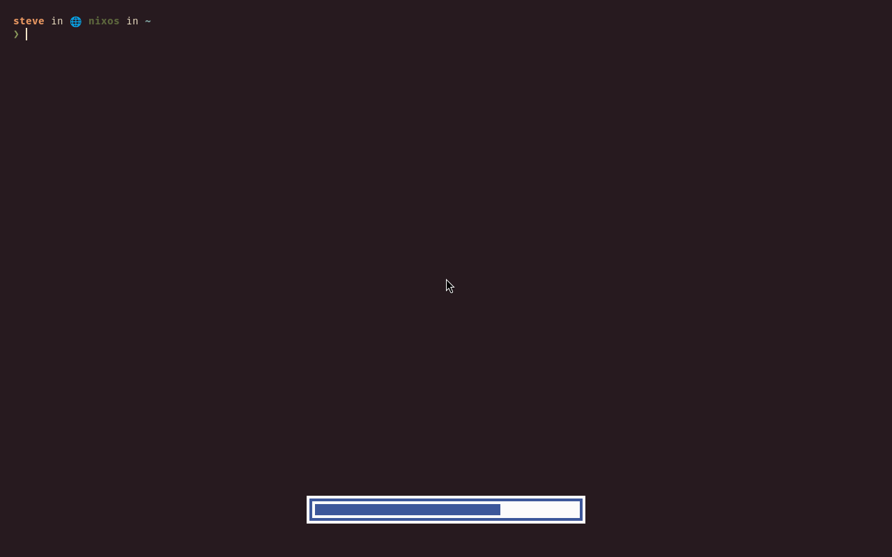

Press a volume key and a bar shows the level; press a brightness key
and a bar shows that instead. Both come on with the profile: PipeWire
with WirePlumber running underneath, the keymap's volume, brightness
and mic-mute binds routed through small scripts that step the control
*and* poke the on-screen display, and a sink helper the Bluetooth
picker calls later.

```nix title="configuration.nix and home.nix"
programs.scoot.desktop = {
  enable = true;
  # No sound or OSD on this box (the binds run silent, as before):
  # audio.enable = false;
  # A longer on-screen hold (default 1.5 s):
  # audio.osd.timeoutMs = 2500;
};
```

What each press does: volume steps the default sink 5% (`wpctl`,
fractions and percents both parsed, so `1.05` shows as 105), mute
toggles it, mic-mute toggles the default source, brightness steps
*every* backlight device the same relative amount, and the bar shows the rounded average. Past 100%
(a `5%+` past full) the bar clamps into an urgent fill: over-amplified
reads as a warning. Muted is the same bar washed
out. Media keys stay silent: play state
already shows in the bar's media module. Keyboard backlight LEDs are
stepped by nothing (class `leds`, reserved and unbound — see the
keymap below).

The OSD draws on the **`overlay`** layer with the look's colors
(background and text, accent fill, active-ring border, dim while
muted, urgent past full), above fullscreen windows — a fullscreen
game never swallows the volume bar (captured from a real session
through scoot's own IPC screenshot path, music-desk paper and blue
over a fullscreen terminal):



It holds nothing when hidden: the daemon blocks until the next key
press, keeps no surface, and wakes nothing (measured below). The
bar's `volume`, `brightness`, `media` and `microphone` modules stay
the persistent display; the OSD is the transient one.

Why PipeWire *with* WirePlumber: `wpctl` is WirePlumber's own CLI —
a PipeWire-only shape would leave the binds with nothing to call, and
no session manager means no default-device memory either. The saving
is ~4.7 MiB (measured at the pinned rev, `aarch64-linux`: NAR bytes
new over `pipewire` itself). No effects, no per-app routing UI: out
of scope for this slot.

Why wob, measured at the pinned rev (`8ce4ef6`, `aarch64-linux`:
full closures by `nix path-info --closure-size`, marginals as new
store paths over the profile's own tools, idle RSS as VmRSS, wakeups as
context-switch deltas over 62 s hidden, all on
the M2):

| Tool | Version | Full closure | New over profile | Idle RSS | Wakeups hidden | Why / why not |
|---|---|---|---|---|---|---|
| wob | 0.16 | 57.5 MiB | 225 KiB (2 paths: itself plus inih) | ~2.2 MB | 2 in 62 s | the pick: no toolkit (wayland, inih, seccomp), `overlay` in its own source, hides itself after the timeout, per-output sections, one `value [style]` line per press |
| swayosd | 0.3.1 | 1.06 GiB | 228 MiB (49 paths) | never runs here | — | a GTK4 stack (gtk4, layer-shell, pulse, ffmpeg, cups, avahi…) at ~19× the closure and ~1000× the marginal — and it *replaces* `wpctl`/`brightnessctl`/`playerctl` with its own backends instead of composing with the ticket's tools |
| a scootbar popup | — | 0 | 0 | 0 | — | rejected on complexity, not size: a key-driven transient OSD is a new surface role plus IPC plus an auto-dismiss timer in the bar's Rust, and it forces the bar on for the OSD (the profile lets you turn the bar off) — three wrapper scripts and no new protocol instead |

Every value is an option, applied on rebuild/switch (the unit
restarts into the new config; no re-login):

| Option | Type | Default | Meaning |
|---|---|---|---|
| `desktop.audio.enable` | bool | `true` with the profile | PipeWire with WirePlumber running, the OSD unit and scripts, the binds routed through them |
| `desktop.audio.daemon` | enum (`"wob"`) | `"wob"` | the program behind the OSD (a future scoot OSD widens this without renaming anything) |
| `desktop.audio.osd.timeoutMs` | int (ms, at least 0) | `1500` | how long the OSD stays mapped after the last step |
| `desktop.audio.osd.package` / `.dumpPackage` | package or null | wob / pipewire (Linux-only: null off Linux) | point at your own builds; null with the switch on fails evaluation naming it |
| `desktop.theme.targets.osd.enable` | bool | `true` | theme the OSD from the look; `false` keeps wob's own black-and-white (mute stays readable through a fixed gray style) |

Switching sinks — speakers, headphones, a Bluetooth headset — from a
terminal or a script (the Bluetooth picker's *Audio output…* row runs
the same helper — see [WiFi and Bluetooth](./network.md)):

```sh
scoot-audio-sink list          # id plus name, one per line
scoot-audio-sink set 43        # by id, or by exact name
scoot-audio-sink cycle         # next after the current default, wrapping
```

`set` and `cycle` move the default and show its level on the OSD.
One sink cycles onto itself with a message.
Apple Silicon speakers keep their own tuning: the M2's hand-wired
speakers-heal unit stays yours to fold in (a user unit ordering after
PipeWire) — the profile just runs the sound server, it does not voice
your hardware.

With no audio hardware at all — a headless box, a VM with no sound
card — every bind fails loud per entry (the script's own message on
stderr, exit 1: `scoot-audio-sink list` says no sinks, a volume step
says no device) and the session carries on: a bind is one `spawn`,
and input never wedges. A null tool beside `audio.enable` fails at
evaluation instead, naming the option.

Troubleshooting, by symptom:

- *A volume or brightness key does nothing.* Check the control first,
  not the bind: `wpctl get-volume @DEFAULT_AUDIO_SINK@`,
  `brightnessctl -c backlight -m -l`. Then the daemon:
  `systemctl --user status scoot-osd` — a dead unit means the fifo is
  missing and every step says "no OSD running". Then the bind reached
  the file (`[binds]` in `~/.config/scoot/config.toml`).
- *The step lands but no bar shows.* The OSD missed the fifo: same
  unit check as above. The step warns ("the step landed, the OSD did
  not show") and exits 0 — the control is fine, the display missed.
- *The bar never hides.* Something keeps feeding the fifo, or the
  timeout is huge: read `~/.config/wob/wob.ini` (the generated
  file), the first content lines are the timeout.
- *`scoot-audio-sink list` is empty.* No sinks: PipeWire runs with
  nothing behind it (a VM, or Bluetooth mid-reconnect). `cycle` with
  one sink stays put and says so.
- *Two bars stack.* A second OSD runs beside this one (another wob,
  or swayosd): turn this one off (`audio.enable = false`) or
  uninstall the other.
- *The bar shows the wrong screen's brightness.* It shows the
  average across backlight devices — one bar for the whole
  desk.
