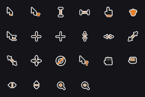

scoot draws no titlebars by design — a focused window gets a colored
ring drawn *around* it (in the layout's own gap), and there's a solid
background behind everything. This table controls the ring, the
background, and the built-in pointer cursor. Everything here re-applies
live by `scoot msg reload`.

| Field | Type | Default | Meaning |
|---|---|---|---|
| `focus_ring_width` | integer (pixels) | `3` | Ring thickness around the focused window, drawn around what the window actually draws (a window smaller than its slot is ringed where its content ends). Clamped to at most half of `gap`. |
| `focus_ring_inactive_width` | integer (pixels) | unset (same as `focus_ring_width`) | Ring thickness around every window that is not focused. `0` draws no ring at all on unfocused windows. |
| `focus_ring_active_color` | `"#rrggbb"` / `"#rrggbbaa"` | `#6ba6fa` (accent blue) | Ring color around the focused window. |
| `focus_ring_inactive_color` | `"#rrggbb"` / `"#rrggbbaa"` | `#595961` (muted gray) | Ring color around every other window. |
| `background_color` | `"#rrggbb"` / `"#rrggbbaa"` | `#141419` (near-black) | Cleared behind all window content — the frame clear color; what shows wherever [wallpaper](../scootbg/index.md) shows nothing. |
| `corner_radius` | integer (pixels) | `0` (square) | Window corner radius in logical pixels. Rounds window content and ring together; clamped per window to half its smaller dimension. Costs a little per frame when non-zero. Popups stay square. |
| `cursor_size` | integer (pixels) | `16` | Both dimensions of the built-in pointer cursor bitmaps (clamped `4..=256`; drawn only under `--tty`). Also picks which size is taken out of a real cursor theme. The fallback shapes are a 22-shape anti-aliased family drawn for this compositor (not theme copies) and upscale cleanly to fractional output scales — see [the fallback family](#the-fallback-cursor-family) below. |
| `cursor_color` | `"#rrggbb"` / `"#rrggbbaa"` | `#1a1a1a` (near-black) | Body fill color of the built-in pointer cursor. The rim auto-contrasts the body (dark body → white rim, light body → black rim, both at the fill's own alpha), so setting this to white reproduces the old white-pointer look. A translucent fill genuinely composites (body, rim and accent all follow its alpha). The arrow alone carries a soft drop shadow at 28% of that alpha. No effect inside a real theme's artwork. |
| `cursor_accent` | `"#rrggbb"` / `"#rrggbbaa"` / `"none"` | `#e57f29` (ginger orange) | The small ginger mark each fallback shape carries: the arrow's tail hint, the paw badge, the resize bars' centre line, the "not allowed" slash, and friends. `"none"` (any case) draws no mark; an unset or empty value keeps the default. Follows the body's alpha, so a translucent body never wears an opaque mark. No effect inside a real theme's artwork. |
| `cursor_theme` | string | unset | Which installed xcursor theme named cursor shapes are drawn from. Unset follows `$XCURSOR_THEME`, then `default`. A name matching nothing installed is not an error: named shapes come from scoot's own drawn set. |
| `cursor_hide_after_ms` | integer (milliseconds) | `0` (never hides) | How long the pointer sits still over a covering fullscreen window before scoot hides it. While hidden, frames carry no cursor elements, so a fullscreen window can scan out directly even where the pointer cannot ride a plane of its own (no cursor plane and no free overlay, the pointer at a screen edge, a client's shared-memory cursor image; see [backends](./backends.md#which-renderer-draws-the-frames)). Next motion, button or scroll shows it again. Never arms behind the session lock. |
| `prefer_no_csd` | boolean | `true` | Answer decoration requests with `ServerSide`, so a well-behaved client stops drawing its own titlebar (which would double up with the ring). |

```toml
[appearance]
focus_ring_width = 4
focus_ring_inactive_width = 2
focus_ring_active_color = "#ffaa00"
focus_ring_inactive_color = "#333333"
background_color = "#101014"
corner_radius = 8
cursor_size = 16
cursor_color = "#1a1a1a"
cursor_accent = "#e57f29"
```

Under home-manager with Stylix, the ring and background colors and the
cursor theme and size default from the scheme instead — a value written
here always wins. The three built-in color defaults are stored as raw
floats no hex string reproduces exactly: leave a color field unset to
get the real default; only set it to change it. (The two cursor colors
are exactly representable — `#1a1a1a` and `#e57f29` — the exceptions.)

The look you picked in [the desktop profile](../desktop/index.md#pick-a-look)
writes these same keys — `settings.appearance.background_color =
"#123456"` beside a look replaces that one color and keeps the rest.

## The fallback cursor family

Where no cursor theme is installed (a webtop or minimal container, the
everyday case), scoot draws its own 22-shape pointer family: a near-black
body, a contrasting rim, and one ginger mark per shape. Every shape is
original vector geometry drawn by the compositor itself — no theme's
pixels, embedded or copied.



| Shape | Drawn for these requests |
|---|---|
| Arrow (tail hint) | `default`, `context-menu` |
| Arrow + paw badge | `progress`, `alias`, `copy` |
| I-beam (orange stem) | `text` |
| Side I-beam (orange stem) | `vertical-text` |
| Pointing glove (orange cuff) | `pointer` |
| Paw print | `dnd-ask` |
| Arrow + hourglass badge | `wait` |
| Cross (orange centre dot) | `crosshair` |
| Thin cross | `cell` |
| Double arrows (orange centre line, dashed on diagonals) | the eight edge resizes (`n-`, `s-`, `e-`, `w-`, `ne-`, `nw-`, `se-`, `sw-`, `ns-`, `ew-`, `nesw-`, `nwse-resize`) |
| Four-arrow star (orange centre dot) | `move`, `all-scroll`, `all-resize` |
| Ring (orange slash) | `not-allowed`, `no-drop` |
| Arrow + "?" badge | `help` |
| Open hand | `grab` |
| Closed fist (orange knuckles) | `grabbing` |
| Split triangles (orange divider) | `col-resize`, `row-resize` |
| Magnifier (orange plus / minus) | `zoom-in`, `zoom-out` |

> **Symptom:** the pointer is a plain arrow everywhere.
> A real cursor theme answered first: `cursor_theme` (or `$XCURSOR_THEME`)
> resolved, and the theme supplies that shape. Unset the theme to see the
> drawn family.
