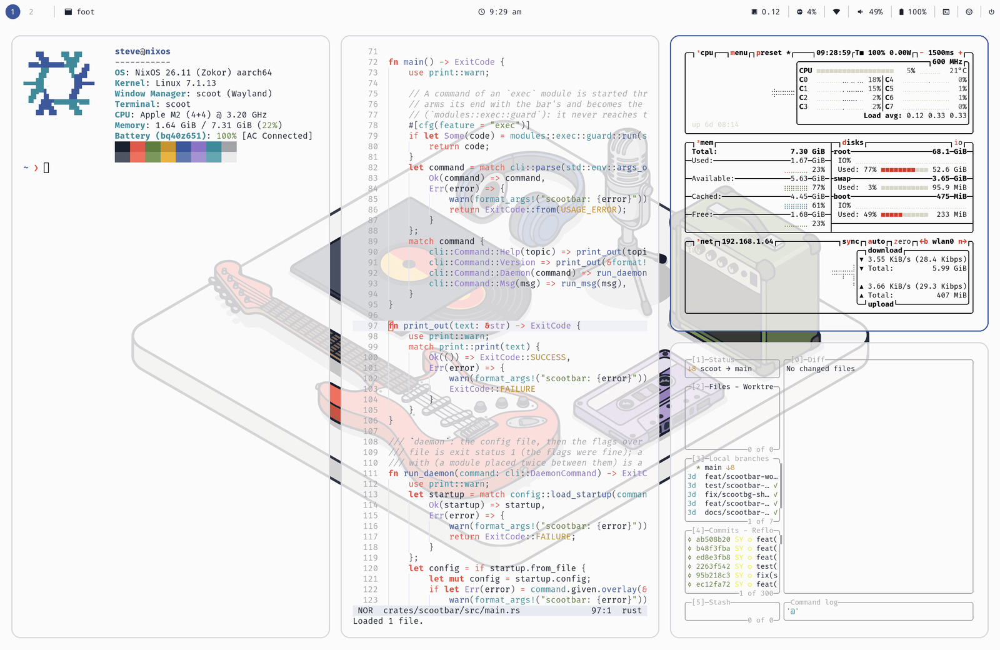
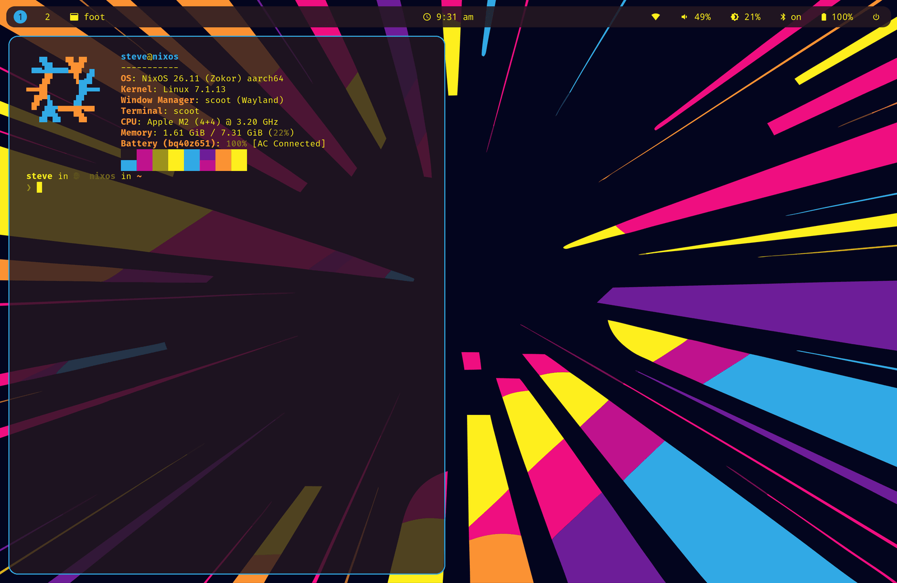
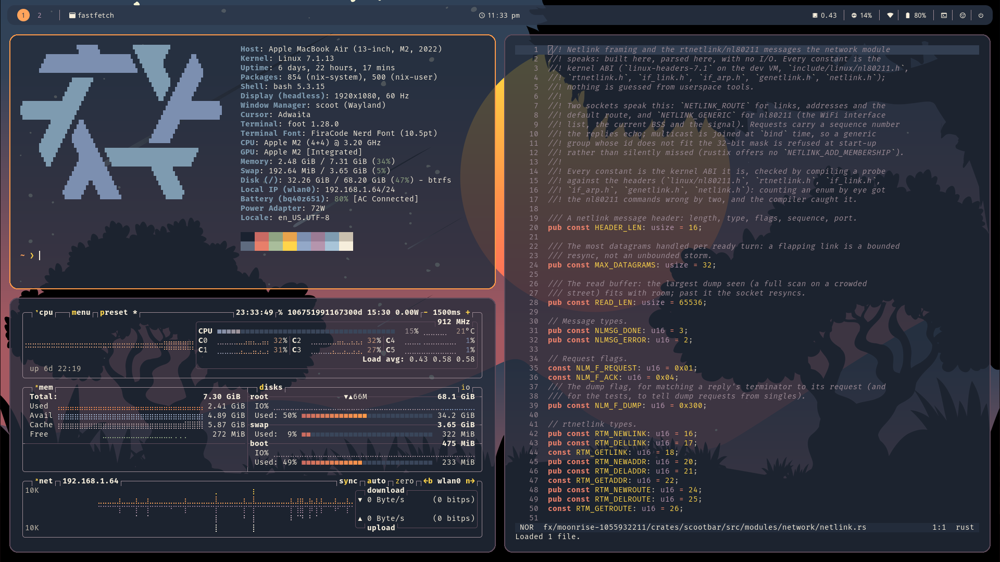

Make the whole desktop match one look: compositor ring and
background, bar colors, session wallpaper, GTK and Qt apps, cursor,
fonts, dark mode, the login screen, and the terminal, prompt, editor
and monitor configs — from one `look` choice. Set it in [the desktop
profile](../desktop/look.md#pick-a-look):

```nix title="configuration.nix and home.nix"
programs.scoot = {
  desktop.enable = true;
  look = "music-desk";   # "ginger-night" (default) | "vinyl-sunset" | "radial-burst" | "moonrise" | null (no theming)
};
```

The default is `ginger-night` (the cat-peeking look): an empty
`desktop` config themes. Set `look = null` explicitly to theme
nothing. `programs.scoot.looks` lists the catalog (default: every
shipped look — add paths to your own source look directories beside
the names). Each look renders at build time; each activation runs
`scoot look sync`, which starts a fresh state on the declared default, switches when it
changed, falls back when the live choice left the catalog, and
otherwise keeps the live choice. A swap (`scoot look apply`, the
`Mod+Shift+T` cycle, the IPC request) takes effect at once; the
declaration only wins when it changes.

| Look | Ring / background | Wallpaper | |
|---|---|---|---|
| [`ginger-night`](https://github.com/scoot-sh/scoot/tree/main/looks/ginger-night) | ginger `#FF9A30` on near-black `#0E0E0E` | ships (`fit` on the look's black, so the cat is never cropped) |  |
| [`music-desk`](https://github.com/scoot-sh/scoot/tree/main/looks/music-desk) | blue `#3D579A` on paper `#FCFBFB` | ships |  |
| [`radial-burst`](https://github.com/scoot-sh/scoot/tree/main/looks/radial-burst) | blue `#31a9e5` on plum `#241721` | ships |  |
| [`moonrise`](https://github.com/scoot-sh/scoot/tree/main/looks/moonrise) | amber `#FF9A49` on slate navy `#2B3648` | ships |  |
| [`vinyl-sunset`](https://github.com/scoot-sh/scoot/tree/main/looks/vinyl-sunset) | orange `#FE9949` on espresso `#270E0A` | ships |  |

Each look's tokens live in `looks/<name>/look.toml`, in the [look format](../reference/look-format.md): the same manifest on a Nix install and a plain binary install, with no Nix-only step anywhere in it. A check validates and renders every look there and fails on a missing role.

A headless session (`scoot --headless`, the agent and CI path) starts on
a private copy of your look choice: swaps inside it never touch your
desktop. `--tty` and `--nested` sessions use your choice directly, so
their swaps survive a restart; `--private-look` gives any session a
private copy instead. See [backends](./backends.md#private-look-state).

(Previews: real screenshots of each example, captured from live
sessions.)

## What one look sets

The compositor and the bar read the active look as a runtime layer
under your own files: per key, your file wins, then the look, then
the app default (`[wallpaper]` is one unit — a key of yours there
keeps your whole section). A swap never rewrites your files, and
nothing sits above the look except your own values. GTK, Qt and the
rest below still read files, so a look change reaches
newly started apps, running ones where their toolkit watches:

| File the profile writes | From the look | Takes effect |
|---|---|---|
| the look layer (`~/.local/share/scoot/rendered/<name>`, pointed at by the state link) | ring colors and widths, background, corners, cursor, bar colors and style, the wallpaper | live, on apply or sync |
| `~/.config/gtk-3.0/settings.ini`, `~/.config/gtk-4.0/settings.ini` | Adwaita (Adwaita-dark for a dark look), Adwaita icons, the look's proportional sans and cursor, the dark preference | Next launch; running apps do not re-read it (the keys that also live in dconf follow live, next row) |
| `~/.config/gtk-3.0/gtk.css`, `~/.config/gtk-4.0/gtk.css` | the look's text selection (GTK 3) and accent and surfaces (libadwaita) | Next launch: GTK 3 selection plus libadwaita follow; plain GTK 4 keeps its stock accent; running apps keep their palette (`gtk.css` is never re-read) |
| dconf `org.gnome.desktop.interface` (`color-scheme`, `gtk-theme`, `icon-theme`, `cursor-theme`, `cursor-size`, `font-name`), written by `scoot look apply` | `prefer-dark` for a dark look, `prefer-light` for the light one, the Adwaita theme in the look's polarity, Adwaita icons, the Mocu cursor at 24, the proportional sans | Live: GTK 4 and libadwaita follow through the portal; GTK 3 follows the theme, icons, cursor and font through GSettings directly (`color-scheme` means nothing to GTK 3) |
| `~/.config/qt6ct/qt6ct.conf` (through `QT_QPA_PLATFORMTHEME=qt6ct`) | the Adwaita Qt style in the look's polarity, Adwaita icons, and `custom_palette` pointing at the scheme below | Next launch for the style; running Qt apps keep their palette (an in-place scheme change fires no watcher — measured against qt6ct 0.11) |
| `~/.config/qt6ct/colors/scoot-look.conf` | a color scheme generated from the look's palette (dark looks get a dark palette, the light look a light one) | Next launch; under the Adwaita style QWidget apps keep Adwaita's fixed palette instead (measured) — a style honoring `custom_palette` paints the scheme |
| `~/.config/fontconfig/conf.d/10-scoot-look.conf` | the proportional sans for sans-serif and system-ui, the terminal face for monospace, each only when it is the first family a client asks for | Next font lookup (fontconfig rescans lazily); `fc-cache` is not needed |
| `~/.config/foot/foot.ini` | the example's own file | foot on restart |
| `~/.config/starship.toml` | the example's own file | next prompt |
| `~/.config/helix/config.toml` + `themes/<look>.toml` | the example's own files | Helix on restart |
| `~/.config/nvim/colors/scoot-look.lua` (+ `plugin/scoot-look.lua` with `targets.editor.nvim.enable`) | the look's own colorscheme (loaded on demand; selected only with `nvim.enable`) | running nvim recolors live (its own file watcher); new nvim reads it at startup |
| `~/.config/btop/btop.conf` + `themes/<look>.theme` | the example's own files | btop on restart |
| `~/.local/share/fcitx5/themes/scoot-look/theme.conf` (needs `inputMethod.enable`) | a classic-UI theme generated from the look's palette (accent selection, background surfaces) | fcitx5 on restart (the unit restarts into a new theme) |
| `~/.config/fcitx5/conf/classicui.conf` (needs `inputMethod.enable`) | `Theme=scoot-look` (plus `DarkTheme=scoot-look` for the portal dark path) | fcitx5 on restart |
| ReGreet (NixOS, needs `greeter.enable`) | the session wallpaper behind the login card, the dark setting, the look's CSS and proportional sans | next login |

An upstream home-manager module owns the paths it actually writes:
`gtk.enable` owns both `settings.ini` files (its `extraCss`/theme
the `gtk.css` files) and `qt.enable` with `qt6ctSettings` owns
`qt6ct.conf` — the look's file stays out of each owned path while the
rest stays themed. A key you or another module sets under
`org.gnome.desktop.interface` stays home-manager's too: the catalog
records it beside the declared default, and `sync` leaves it alone.

Visible change with this setup: the shipped looks now carry their
shape — rounded windows, ring widths, bar padding and spacing — where
the Nix path used to apply only colors, fonts and the wallpaper (the
bar is translucent: its opacity holds the example value the
bar-opacity benchmark cleared). To keep square windows,
set `settings.appearance.corner_radius = 0`: your file wins per key.

`radial-burst` ships no shell, editor or monitor files, so those
three targets are inert for it; `music-desk` ships a btop config with
no theme file.

Two session variables carry the theme into apps:
`QT_QPA_PLATFORMTHEME=qt6ct` (reads the config above) and
`QT_PLUGIN_PATH` (the qt6ct and Adwaita-Qt plugin dirs). A value you
set for the user session wins whole; shells compose instead — the
theme's plugin dirs ride `home.sessionSearchVariables`, which
home-manager prepends before your own `$QT_PLUGIN_PATH` at login —
so put extra plugin dirs there to keep both.

Per-target opt-out is Stylix-style, under one namespace, one flag per
themed piece (every target defaults on) — see the [option
table](../desktop/look.md#app-theme) for the full list:

```nix title="home.nix"
programs.scoot.desktop.theme.targets.lock.enable = false;  # keep swaylock's own style
```

`desktop.bar.enable` keeps its meaning ("manage the bar at all") and
is never a theme switch.

## What stays a static file, and why

Generated from the look's palette where the format is mechanical:
`settings.ini`, `gtk.css`, `qt6ct.conf` and its color scheme, the
fontconfig snippet, the ReGreet dark setting, the cursor and font
names. Installed as the example's own static file where the palette
is hand-tuned: `foot.ini`, `starship.toml`, the Helix config and
theme, the Neovim colorscheme, the btop config and theme, and `regreet.css`. A terminal
palette is sixteen hand-placed hues, not six bar roles projected
wider — generating it would invent colors no one chose, so the flake
applies the file instead of synthesizing one.

Card rules in `regreet.css` stay scoped to `frame.background`, never
bare `frame`: ReGreet's login card and its clock card carry the
`background` class, while the empty notification bar above Reboot/Power
Off carries none (read against ReGreet 0.5.0's
`src/gui/templates.rs`). A bare `frame` rule also inks that empty bar,
leaving a blank card when there is nothing to report (GTK CSS has no
`:empty`). The five shipped sheets scope theirs, and the card-scope
gate (`scripts/check-regreet-css-scope.sh`, run by the docs-site CI
job) refuses a bare `frame` selector in any of them or in a docs CSS
snippet. Writing your own sheet? Copy the header comment's rule:
`frame.background` (and `frame.background > border` for the inner
border) for the cards, nothing bare.

> **Symptom:** an empty rounded card above Reboot/Power Off on the login screen.
>
> The greeter CSS styles bare `frame`, which also matches ReGreet's
> empty notification bar. Scope the card rules to `frame.background`
> (see above); the shipped looks already do.

The app accent is the bar's own accent, and the app surfaces are the
bar's background and foreground — no new hues, so app text contrast
equals bar text contrast (measured at AA in the module checks).
Semantic colors (destructive, success, warning, error) stay the
toolkit defaults: the look names no hues for them, and inventing any
would break the same rule.

One face stays mono on purpose: the bar keeps its Droid Sans Mono
Nerd Font Propo, whose glyphs carry the module icons. Everything else
that reads as UI text — GTK and Qt apps, the greeter, fontconfig
sans-serif — gets the proportional DejaVu Sans. It is the only
proportional face the profile already ships (the bar's own fallback
file), so it adds zero closure; per look, its humanist warmth pairs
with vinyl-sunset's espresso dusk, its bookish neutrality suits
music-desk's paper, its sturdiness holds radial-burst's poster
colors, and its open apertures stay legible on moonrise's
translucent slate. The mono faces stay for terminals and editors
only.

## Dark mode, X11 and Flatpak

Each look declares dark or light (`music-desk` light, the other
four dark): that drives `gtk-application-prefer-dark-theme`, the
Adwaita variant on both toolkits, the toolkit keys `apply` and `sync`
write, and the greeter's dark setting.
X11 apps through XWayland read the same `settings.ini` and
`qt6ct.conf` — no settings daemon runs for them, and the theme sets
no `Xft.dpi`: the compositor publishes the output scale and XWayland
follows it. Flatpak apps need the config files exposed into the
sandbox — see the [Flatpak
symptom](../desktop/look.md#app-theme).

## Stylix

With Stylix in use (`config.lib.stylix` exists and `stylix.enable`
is on), the catalog gains a look named `stylix`, synthesized from
the Stylix palette at build time, and the declared default follows
it. No app module reads Stylix: it reaches the desktop only as that
look. Nothing here needs Stylix, and nothing changes without it.

The look carries the sixteen base16 slots as its palette, the
sans-serif and monospace faces, the `desktop` / `popups` /
`applications` / `terminal` sizes, the `popups` and `terminal`
opacity, the cursor name and size, and `stylix.image` with its
scaling mode. Everything the palette does not set comes from the
base look: the wallpaper when no image is set, the terminal hues and
static editor files, the night temperature, and the shape and
opacity. Dark or light follows `stylix.polarity`. A face or cursor
name the look grammar cannot carry (a non-Latin name, for example)
is left out with a warning naming it: the faces fall back to the
base look's, the cursor to the default.

- `programs.scoot.stylix.enable` — Type: bool. Default: `true`.
  Synthesize the `stylix` look and make it the declared default. Set
  to `false` to drop the synthesis with Stylix present.
  ```nix title="home.nix"
  programs.scoot.stylix.enable = false;
  ```
- `programs.scoot.stylix.extends` — Type: null or string. Default:
  `"ginger-night"` with the desktop profile on, null otherwise. The
  base the synthesized look extends; it resolves through `looks`, so
  list a custom base there. Null extends nothing: the Stylix palette
  alone.
  ```nix title="home.nix"
  programs.scoot.stylix.extends = "moonrise";
  ```
- `programs.scoot.stylix.wallpaper.enable` — Type: bool. Default:
  `true`. Carry `stylix.image` and its scaling mode into the look.
  Set to `false` for a solid color: the image stays out, so a
  `color` you set stands alone (the palette, fonts, cursor and the
  rest stay Stylix's).
  ```nix title="home.nix"
  programs.scoot.stylix.wallpaper.enable = false;
  ```

The declared default follows a ladder, highest first: a `look` you
set, then `stylix` while it is synthesized, then the profile's
`ginger-night`, then nothing (plain value, `mkDefault`, `mkOverride
1200`, the option default). To pin a look under Stylix, set `look`;
the live choice in `<state>/look.json` still beats the declaration
until it changes (see `scoot look sync`).

What changes, by setup:

- Profile users with Stylix and no explicit `look`: GTK and Qt
  colors, mako, fuzzel and the pickers, swaylock, wob and fcitx5 move
  from ginger-night's palette to Stylix's, matching the compositor
  and bar. Compositor and bar colors and fonts, the wallpaper, the
  night temperature, and the terminal, shell, editor and monitor
  files stay as they are.
- Stylix with an explicit `look`: the look now wins in the
  compositor and bar where Stylix used to. Paths a Stylix target
  writes stay Stylix's (next paragraph), so the desktop stays split
  until those targets go off.
- Stylix without the profile: nothing visible changes. The `stylix`
  look has no base; its colors, fonts, cursor and wallpaper equal
  what the old per-setting defaults produced.

One look everywhere needs the Stylix targets off: scoot never writes
a path an upstream module owns, so with `stylix.targets.<app>.enable`
on, that app's files stay Stylix's whatever the look. `scoot look
apply` names those apps as owned by Stylix's target; the module
records them in `~/.config/scoot/look-stylix-targets` (gtk, qt,
foot, mako, fuzzel, swaylock, wob, fcitx5, starship, helix, btop).
Turn off each target you want themed:

```nix title="home.nix"
stylix.targets.mako.enable = false;
```

A direct-module setup without the flake's overlay has no `scootbg`
package: the wallpaper default then stays off rather than failing.
Set `programs.scoot.wallpaper.enable = false` explicitly to own the
wallpaper daemon yourself (and point `settings.wallpaper.command`
at it, or leave the section to find `scootbg` on `PATH`).

## Make a look

A look is data, so new ones are cheap. Start from a catalog look, then
watch the directory while you edit it. No step here needs Nix. See
[Authoring](../looks/index.md#authoring) for the full pass.

```sh
scoot look new my-green --from moonrise   # writes user-looks/my-green/look.toml
scoot look watch ./my-green --no-toolkit  # validate and apply on every save
scoot look preview my-green --capture     # screenshot the look into preview.png
```

`new NAME --from BASE` writes a source look with `extends = "BASE"`: the
new look inherits every token and overrides from there. `BASE` names a
shipped, declared or user-authored source look, never an installed one
and never a rendered one. A look made with `new` is user-authored, so it
can be the next `new`'s base. `watch DIR` validates and applies on every
save (debounced, under the lock, into one reused cache slot, so the cache
never grows per save); an invalid save is refused loudly and the last
good look stays. `preview --capture` renders the look in a private
headless session and writes `preview.png` beside its `look.toml`.

A directory still validates with `scoot look validate DIR` and renders
with `scoot look build DIR --out OUT` without applying. The manifest
shape is the [format](../reference/look-format.md): palette, fonts,
opacity, shape, cursor, wallpaper, plus a wallpaper image and, where the
look has its own, terminal and shell files and a preview. Your own looks
live in `~/.local/share/scoot/user-looks/`.
