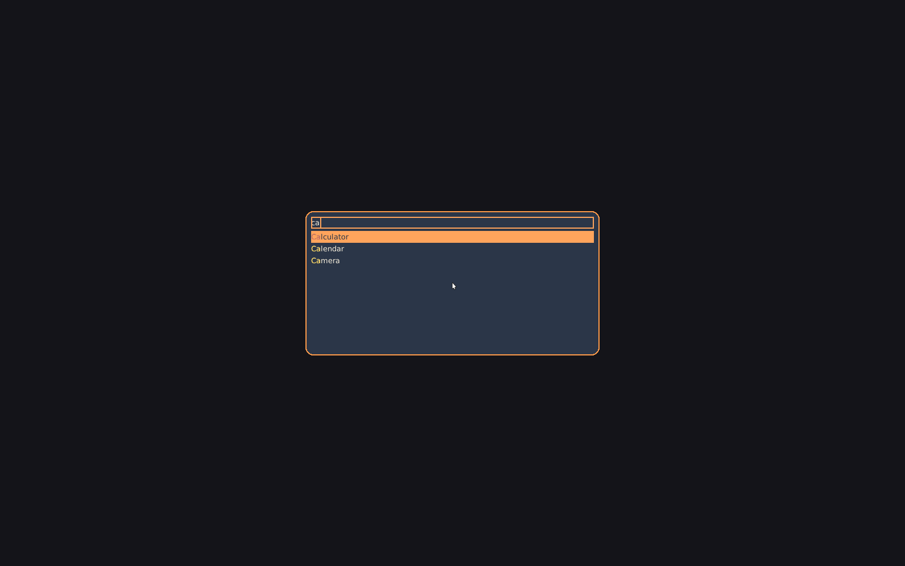
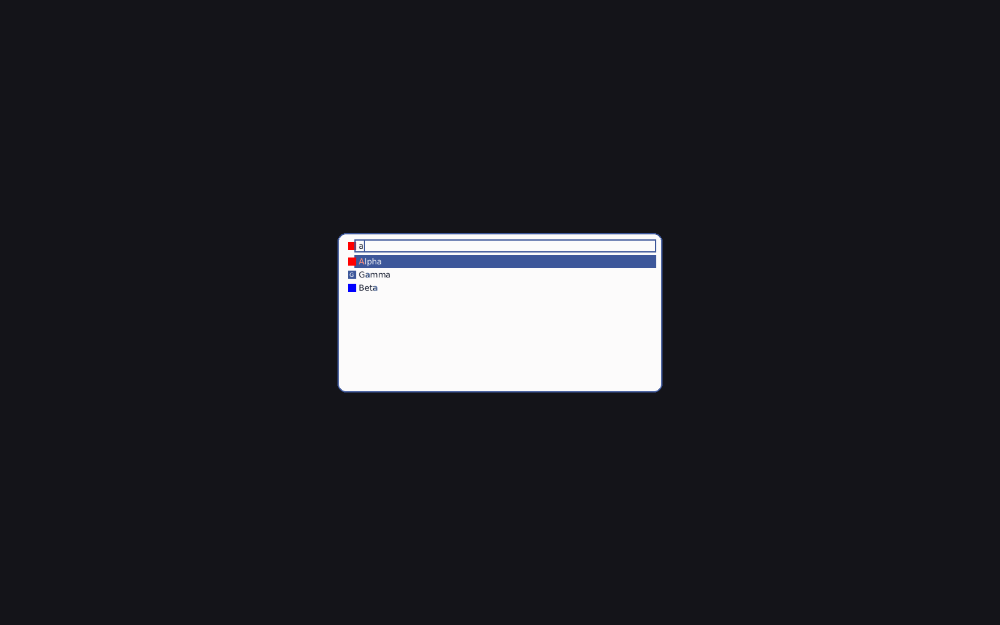

Bare `scootlaunch` opens the panel: an overlay surface with exclusive
keyboard, centered on the output, 40 em wide with 10 rows by default.
Type to filter; Enter picks. The panel holds no surface when closed —
one process per open.

```sh
scootlaunch                          # open the panel
scootlaunch --font /path/to/font.ttf # open with an explicit typeface
scootlaunch --check                  # validate the config file and exit
printf 'a\nb\n' | scootlaunch --dmenu --prompt='pick: '  # pick a line, print it
scootlaunch --run                    # the panel over executables on $PATH
```

Picking launches the chosen entry and exits 0; dismissing exits 1.
Ctrl+Enter runs the typed text as a command. A dmenu pick prints
instead of launching (the line, or its index with `--index`); run
mode launches executables by basename. Flags, the stdin/stdout
contract and exit codes are in the [CLI reference](./cli.md).
Nothing prints for an apps or run launch: the
launch replaces the id the panel used to print. The panel links
`libxkbcommon.so.0` for its keyboard (the reference
XKB implementation); a scoot desktop already carries it.

## Icons

Each row shows one icon before its name. The entry shows the
selected row's icon, so the two texts stay aligned.

| Key | Type / default | Example |
|---|---|---|
| `Icon` (desktop entry) | theme name or absolute path, none (letter tile) | `Icon=firefox` |

Lookup is the Icon Theme spec: the configured theme, its `Inherits`
chain, `hicolor`, then the base directories (`~/.icons`,
`$XDG_DATA_HOME/icons`, each `$XDG_DATA_DIRS/icons`,
`/usr/share/pixmaps`). A name with a slash is an absolute path and is
used directly. A PNG of the right size wins when the theme ships one;
SVG rasterizes through `resvg` (the default-on `svg` feature) only
when no PNG does. Without the feature, or when nothing resolves or
decodes, the row draws a letter tile: the entry's first alphanumeric,
in `accent` with `background` ink.

Only the visible rows load, once per open, into a bounded cache (64
icons, 1 MiB). The keystroke path never touches the cache, so typing
still allocates nothing after warm-up.

Bounds, so a hostile theme or file never panics or stalls: names are
at most 128 bytes with no slash or leading dot; paths are absolute
with no `..`; files are regular, PNG at most 8 MiB (16 MiB decode
budget, 1024 px a side, 1 M pixels) and SVG at most 512 KiB with at
most 20000 nodes, rendered at most 256 device pixels a side with no
network and no system fonts; file hrefs resolve to nothing drawable
unless a valid image. A corrupt file, a huge header, a symlink loop
and a missing theme all fall back to the tile. Icons render at device
pixels: the side is the logical side times the surface scale, so a
1.5 output draws a 1.5x bitmap through the viewport.

The stripped release is 1446648 bytes without `svg` (budget 1.8 MB)
and 2167544 bytes with it (the `svg` row, for the waiver ruling; the
index-only 1053368-byte row predates icons).

## Keys

| Key | Action |
|---|---|
| typing | filters the list |
| Up / Down, Ctrl+P / Ctrl+N, Shift+Tab / Tab | move the selection |
| Page Up / Page Down, Ctrl+Home / Ctrl+End | by page, to the ends |
| Enter | launch the selection |
| Ctrl+Enter | run the typed text as a command |
| Escape | dismiss (exit 1) |

Left/Right, Home/End, BackSpace, Delete, Ctrl+W, Ctrl+U and Ctrl+A
edit the query. In dmenu mode Enter prints the selection (or the
typed text when nothing matches, unless `--only-match` says
otherwise) and Ctrl+Enter always prints the typed text. A click picks
the row; the wheel scrolls. A click on
the bare desktop does not dismiss in v1: with exclusive keyboard the
compositor holds focus, so the click never reaches the panel. A
second `scootlaunch` while the panel is open dismisses it, so one
bind toggles: no pid file, no abstract name, just a socket in
`$XDG_RUNTIME_DIR` with the peer's uid checked, plus a
`scootlaunch-<display>.lock` file that serialises two opens at once.

## Config

`$XDG_CONFIG_HOME/scoot/launch.toml` beside the bar's, or `--config
PATH`. Every key is optional; a missing file is the built-in
defaults. A bad file refuses loudly. `--check` validates without
opening.

| Key | Type / default | Example |
|---|---|---|
| `font` | path, none (first well-known file) | `font = "/usr/share/fonts/TTF/DejaVuSans.ttf"` |
| `width_em` | integer 10–200, `40` | `width_em = 50` |
| `rows` | integer 1–64, `10` | `rows = 8` |

Unknown keys are refused, never ignored.

## What a pick launches

Enter (or a click) on an entry launches it, then the panel closes:

- **Token.** The panel mints an activation token from the key or
  button press that chose the entry, and hands it to the app as
  `XDG_ACTIVATION_TOKEN` (plus `DESKTOP_STARTUP_ID` for X clients).
  A running single-instance app re-activates instead of starting
  over. Past a 200 ms wait the launch goes without a token; a fresh
  window still focuses on map.
- **Environment.** The panel strips its own token first, sets the
  new one, starts the app in `Path=` (else `$HOME`) with stdin from
  `/dev/null`, and records the pick for frecency.
- **Scope.** Each launch gets its own systemd scope,
  `app-scootlaunch-<id>-<random>.scope` under `app.slice`, so the
  app outlives the panel and shows up per-app in
  `systemctl --user status`. The move waits at most 500 ms.
- **Fallback.** With no session bus the app starts detached
  instead (a double fork with `setsid`); it stays in the
  compositor's cgroup. A refused scope move keeps the running app
  where it started, with one warning.
- **`DBusActivatable`.** Entries that say so are asked over
  `org.freedesktop.Application` first (`Activate`, or
  `ActivateAction` for a desktop action), with the token in
  `platform_data`. No owner on the bus falls back to `Exec`.

A spawn failure draws its error in the panel for 2 s and the panel
stays open; nothing is recorded. Ctrl+Enter runs the typed text
split on spaces, under the same rules (its scope derives from the
command's name).

## Theming

The panel reads `<state>/look/launch.toml` at every open: the
thirteen shell-app color roles plus `font`, `font-size`, `opacity`,
`radius` and `[icons] theme`, merged per key as flags, then this file,
then the look, then the built-ins. A refused key keeps its default
and is reported; a missing layer is the defaults with one warning.

| Element | Role |
|---|---|
| Panel fill | `surface` (default `background`), at `opacity.popups` |
| Input and row text | `foreground` |
| Placeholder | `dim` |
| Matched characters | `match` (default `hover`) on plain rows; on the selected row the `match` ink when it contrasts with the fill (at least 3:1), else the inverted chip (row-text ink behind, `accent` over it) |
| Selected row fill / text | `selection` / `selection-text` (defaults `accent` / `background`) |
| Panel border | `focus` (default `accent`) |
| Caret, entry focus ring | `accent` |
| Row icons, tile fill | `accent` with `background` ink (tile letter) |
| Corners | `radius` |
| Size | `font-size` (the look's popup size) |
| Icon theme | `[icons] theme` (default `Adwaita`) |

The `font` key names the look's UI family. There is no fontconfig in
this stack: the panel draws with `--font PATH`, else the first usable
well-known file, as the bar does. Rows show the entry icon with the
name beside it and its match highlighted. A light look draws the same
panel from the same roles:



## Troubleshooting

> **Symptom:** the panel opens on the wrong monitor.

The panel names no output, and an output-less layer surface lands on
the output under the pointer (falling back to the primary when the
pointer is over no output) — the same rule new windows use. If the
panel still opens away from where you are looking, move the pointer
onto that monitor first: the compositor picks the output once, when
the surface maps, and does not move it afterwards.

> **Symptom:** the panel refuses to start over a font.

Give it a file with `--font PATH` (a `.ttf` or `.otf`, such as
DejaVuSans.ttf). Without one it tries a short list of well-known
paths and refuses, naming what it tried.

> **Symptom:** the panel ignores the look.

The panel warns once per fallback on stderr: a dangling or missing
link means no look layer, and a refused key names itself. `scoot look
apply` re-renders the layer; the next open reads it.

> **Symptom:** rows show letters instead of icons.

Letters are the fallback: no `svg` feature (SVG-only names), no icon
theme, or nothing resolved or decoded. With the feature, an SVG-only
entry still needs its theme installed. Check `Icon=` with
`scootlaunch --list --json`, and the theme in
`<state>/look/launch.toml` under `[icons]`.

> **Symptom:** an app starts outside its scope.

`systemctl --user status 'app-scootlaunch-*'` shows which scope an
app landed in. No scope at all means the move was refused or timed
out (500 ms): the app keeps running in the launcher's cgroup, and
the run says why on stderr. A bus with no user manager behind it
answers `ServiceUnknown` the same way; with no bus at all the app
starts detached instead, and the docs say it stays in the
compositor's cgroup.
